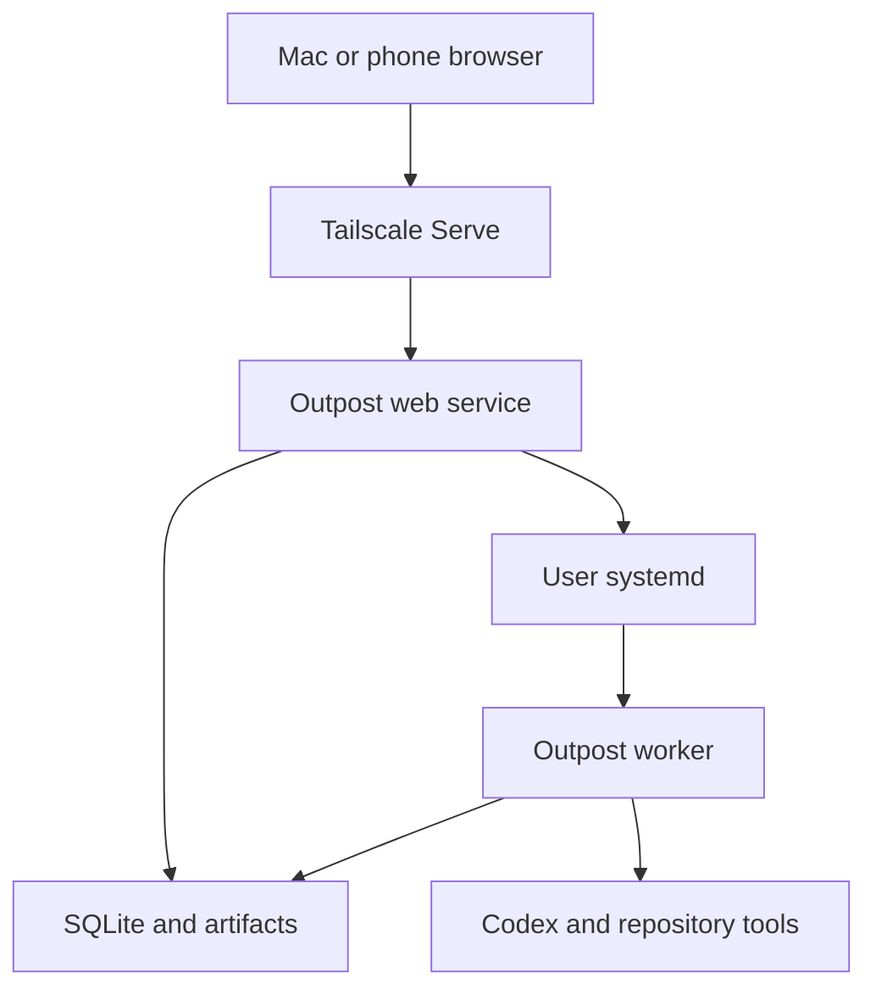

# Outpost — Product and Technical Specification

**Description:** A private control room for your coding agents.  
**Version:** 0.4 specification — working starter, simple CLI sign-in, host installation and multiple projects
**Date:** October 17, 2026  
**Owner:** Félix L’Heureux  
**Target:** A personal GitHub repository and a dedicated Linux machine accessed through Tailscale.

## Contents

- [1. Purpose and status](#1-purpose-and-status)
- [2. Confirmed decisions](#2-confirmed-decisions)
- [3. Scope and release boundaries](#3-scope-and-release-boundaries)
- [4. Engineering principles](#4-engineering-principles)
- [5. Technology and dependencies](#5-technology-and-dependencies)
- [6. Architecture and process topology](#6-architecture-and-process-topology)
- [7. Core vocabulary and state ownership](#7-core-vocabulary-and-state-ownership)
- [8. Operator workflows](#8-operator-workflows)
- [9. Project and workspace model](#9-project-and-workspace-model)
- [10. Task model and eligibility](#10-task-model-and-eligibility)
- [11. Runs, attempts, sessions, and phases](#11-runs-attempts-sessions-and-phases)
- [12. Durable execution and admission](#12-durable-execution-and-admission)
- [13. Agent adapter and Codex integration](#13-agent-adapter-and-codex-integration)
- [14. Instructions and live messages](#14-instructions-and-live-messages)
- [15. Stop, pause, and recovery controls](#15-stop-pause-and-recovery-controls)
- [16. Validation, repair, and completion](#16-validation-repair-and-completion)
- [17. Git delivery and review](#17-git-delivery-and-review)
- [18. Persistence design](#18-persistence-design)
- [19. API contract](#19-api-contract)
- [20. Events, logs, and live updates](#20-events-logs-and-live-updates)
- [21. User interface specification](#21-user-interface-specification)
- [22. Tailscale as a first-class feature](#22-tailscale-as-a-first-class-feature)
- [23. Security and trust boundaries](#23-security-and-trust-boundaries)
- [24. SPA packaging and local development](#24-spa-packaging-and-local-development)
- [25. CLI, installation, and configuration](#25-cli-installation-and-configuration)
- [26. GitHub planning, shared queue, and scheduling](#26-github-planning-shared-queue-and-scheduling)
- [27. Import, export, and VibeEasy transition](#27-import-export-and-vibeeasy-transition)
- [28. Observability and resource behavior](#28-observability-and-resource-behavior)
- [29. Testing and acceptance strategy](#29-testing-and-acceptance-strategy)
- [30. Repository organization](#30-repository-organization)
- [31. Implementation milestones and task handoff](#31-implementation-milestones-and-task-handoff)
- [32. Later feature contracts](#32-later-feature-contracts)
- [33. Acceptance and unresolved implementation details](#33-acceptance-and-unresolved-implementation-details)
- [34. Definition of the first release being done](#34-definition-of-the-first-release-being-done)
- [35. Sources and implementation references](#35-sources-and-implementation-references)
- [36. Revision record and implementation package](#36-revision-record-and-implementation-package)
- [37. Starter repository contracts](#37-starter-repository-contracts)

## 1. Purpose and status

Outpost manages GitHub-backed coding tasks, runs an existing coding agent against a repository, records what happened, validates results, and gives the operator useful controls from a desktop or phone. The normal planning loop is: review pushed changes with ChatGPT, create or revise GitHub Issues, arrange a shared queue, then let the host-side worker implement the work.

The immediate goal is a small tool Félix can use for real VibeEasy development and other repositories. Commercialization, billing, market differentiation, and building a hosted platform are outside the project’s scope. Another developer should be able to install it without adopting VibeEasy’s engineering conventions.

This document specifies the intended application. It does not claim that Outpost has already been implemented, benchmarked, installed, or verified. The existing VibeEasy runner is a behavioral reference, rather than an Outpost release.

The document uses three requirement levels:

- **Must:** Required for the first usable release unless explicitly assigned to a later milestone.
- **Should:** Recommended behavior; an implementation deviation needs a concrete reason.
- **Later:** Deliberately outside the first release.

Details marked **implementation default** are concrete engineering choices supplied by this specification. They make the first version buildable and are not claims that the operator previously selected every limit or field.

## 2. Confirmed decisions

| Area | Decision |
| --- | --- |
| Name | Outpost |
| Purpose | Personal use, quick standalone project, reusable by others |
| Repository | [felixlheureux/outpost](https://github.com/felixlheureux/outpost), public, under the owner’s personal account |
| Backend | Go with Echo |
| Frontend | React, TypeScript, Vite, Tailwind CSS, shadcn/ui |
| Rendering | Client-side SPA |
| Production frontend | Compile the Vite build into the Go executable |
| Persistence | Local SQLite for execution state, source caches, and immutable receipts; private artifact/log files |
| Task specifications | GitHub Issues in the configured project repository |
| Queue authority | One `queue.json` file on a dedicated `outpost/queue` planning branch |
| Live updates | Structured JSON over Server-Sent Events |
| Host | Dedicated Linux machine or VM |
| Access | Tailscale is a first-class part of installation, identity, diagnostics, and daily use |
| Process supervision | systemd; web and runner execution have independent lifecycles |
| Agent foundation | Existing coding-agent harnesses; first adapter is Codex |
| Operator control | Start, stop after task, stop now, steer, resume, retry with instructions |
| Task management | GitHub issue creation/editing, Inbox, ordered Queue, dependencies, holds, eligibility, and execution history |
| Default queue mode | Follow the shared queue between tasks, within a recorded task/runtime budget; fixed scope is optional |
| Main navigation | Queue, Work, History; project menu provides Add repository and project switching |
| Repository onboarding | Zero-project Add repository screen; paste GitHub URL, managed host clone, source setup, then Queue; existing checkout is advanced |
| Validation | Runner-owned check receipts and bounded repair; avoid redundant full gates |
| Git delivery | Configurable by project rather than universally requiring push |
| Completion review | Optional project policy; unattended execution is supported |

FastAPI, Django Ninja, and a Go standard-library-only HTTP application were considered. The selected implementation is Go/Echo. The reason is the desired standalone service and packaging model, with Echo handling routine HTTP work. A performance or memory advantage over Python has not been measured.

## 3. Scope and release boundaries

### 3.1 First usable release: v0.1

The release must support:

1. Documented release/source installation, scoped host dependency setup, guided authentication, diagnostics, and service management on one Linux machine.
2. A Tailscale Serve access path and an allowed operator identity.
3. Add repository by GitHub URL, host-managed cloning and source setup, then add/switch multiple projects with isolated settings/workspaces/history.
4. One active execution slot across the installation as an implementation default.
5. GitHub issue creation/editing, unqueued Inbox, dependencies, holds, and manifest ordering.
6. Import of existing VibeEasy task definitions and a general Markdown import/export format.
7. Manual task runs, follow-queue runs, optional fixed-scope runs, and operator-directed instruction runs.
8. Codex session creation, progress, interruption, steering, and explicit continuation.
9. Durable run/attempt records and recovery after process interruption.
10. Configurable local checks with recorded outcomes and bounded repair.
11. Local changes, commit, or push delivery policies.
12. A responsive React interface with readable progress, checks, changes, and instructions.
13. Bounded log viewing, artifact downloads, basic disk diagnostics, and manual retention.
14. Focused behavioral verification and one actual host journey.

The first release is useful only when Félix can run real repository work through it from his phone and Mac. A dashboard that displays simulated activity without controlling the actual worker does not satisfy this release.

### 3.2 Useful follow-up work

The following should be designed around existing boundaries but implemented only after the first release is usable:

- AI-assisted planning that proposes tasks and dependencies for review.
- A second coding-agent adapter to test the provider boundary.
- Per-project concurrent execution, with real workspace and dependency isolation.
- Pull-request creation and richer GitHub review interactions.
- Inline diff comments and comments sent back to an agent.
- Browser or operating-system notifications.
- Optional Kanban view and dependency graph.
- Per-task worktrees and branch integration policies.
- Better historical search, usage summaries, and retention automation.
- Additional authentication/access modes for people who do not use Tailscale.
- Native macOS or Windows supervision.

### 3.3 Explicit exclusions

The first release does not include hosted multi-tenancy, billing, subscriptions, team administration, arbitrary distributed workers, a plugin marketplace, a custom AI harness, Kubernetes, a workflow designer, or a general-purpose automation platform.

Tailscale’s daemon, Git, agent CLIs, and repository toolchains remain installed host prerequisites. Packaging the dashboard into one executable does not package every external program used by a coding task.

## 4. Engineering principles

1. **One owner for each fact.** GitHub Issues own task definitions; the planning-branch manifest owns queue order. SQLite owns execution state, cached source observations, and historical receipts. systemd and OS inspection establish process liveness. Git establishes source and delivery facts. Agent prose does not establish verified completion.
2. **Persist intent before external effects.** Record the exact assignment and launch identity before asking systemd to start a worker.
3. **Reconcile uncertainty.** An HTTP timeout, disconnected browser, or missing acknowledgement does not prove an action failed.
4. **Preserve unfinished work.** Recovery does not reset, stash, discard, or bulk-commit changes to make a workspace look clean.
5. **Keep scopes explicit.** Task status, attempt outcome, provider session, and execution phase are separate concepts.
6. **Use appropriate libraries.** A dependency earns its place by reducing concrete implementation or maintenance work.
7. **Keep the application small.** Avoid abstractions whose only purpose is a hypothetical future deployment.
8. **Make ordinary recovery ordinary UI.** Blocked work should not require deleting lock files or editing SQLite.
9. **Spend validation deliberately.** Formatting, focused checks, final acceptance, metadata closeout, and delivery have distinct purposes.
10. **Show evidence and limits.** A check result, message acceptance, imported status, or manual decision is labeled according to what it actually proves.

## 5. Technology and dependencies

### 5.1 Backend

| Component | Selection | Responsibility |
| --- | --- | --- |
| Language | Go | Backend and runner implementation |
| HTTP | Echo | Routing, middleware, request binding, common HTTP errors |
| Database API | database/sql | Transactions and connections |
| SQLite driver | modernc.org/sqlite | CGO-free SQLite integration |
| Query generation | sqlc | Typed Go query code generated from SQL |
| Migrations | Goose library | Embedded, versioned SQL migrations |
| Input validation | Explicit request DTO checks; validator only if needed | Invoke validation at the API boundary; domain constraints stay in services |
| Git and GitHub | Native Git + authenticated official `gh` CLI | Checkout operations versus GitHub API; reuse existing login without copied keys |
| systemd integration | coreos/go-systemd/v22/dbus when OP-002 needs it | User-instance connections and transient-unit lifecycle |
| CLI | Cobra | serve, worker, install, doctor, and operational commands |
| Logging | log/slog | Structured process diagnostics |
| Assets | embed and io/fs | Embedded frontend and migration files |
| External processes | os/exec and OS-specific process helpers | Agent and Git invocation |
| Tests | testing, httptest, temporary directories, real disposable SQLite/Git | Behavior and integration checks |

sqlc is a development-time tool; it generates normal Go source. Goose must be used as a library with the required database driver, rather than embedding a general CLI build containing unrelated drivers.

Pin actual versions in go.mod/go.sum during implementation. Current Echo documentation uses v5; middleware and examples must match the selected major version. Record and test the actual Codex protocol version separately.

Echo does not provide application-specific data validation automatically. Request DTO validation must be invoked explicitly. Queue eligibility and state-transition constraints belong in the owning application service and database transaction, rather than solely in struct tags.

### 5.2 Frontend

Use:

- React with TypeScript.
- Vite for local development and production compilation.
- Tailwind CSS and shadcn/ui for components and styling.
- TanStack Query for server data, mutations, and cache invalidation.
- TanStack Router with typed file routes for project/task/run URLs and validated URL state.
- Zod for runtime validation of HTTP response contracts.
- The browser’s EventSource API for the SSE connection.

Use the same QueryClient in Router context; route preloading calls Query rather than maintaining a second data authority. Vite generates the route tree and splits routes at build time. TanStack Start and server rendering are unnecessary. Current dependency and setup decisions are recorded in docs/dependencies.md; exact versions are pinned in the manifests/lockfile.

Use component state for temporary interaction state and TanStack Query for server state. Avoid keeping independent, competing copies of task/run data in several frontend stores.

### 5.3 Why these choices fit

The workload is primarily orchestration: HTTP requests, waiting on external processes, reading bounded output, updating a small local database, and streaming state to a few browser sessions.

The selected stack supports this workload without adding a database server or message broker. The resource impact must still be measured. Go does not automatically fix poor log handling, long transactions, duplicate workers, or unbounded frontend rendering.

## 6. Architecture and process topology

Outpost is one application repository and one release executable. The executable has separate commands for its web service and worker. They run as independent processes.



The web service:

- Serves the embedded frontend.
- Authenticates the operator.
- Exposes task, run, and configuration APIs.
- Reserves execution and requests worker launch.
- Records control/message requests.
- Projects durable state into JSON and SSE.

The worker:

- Claims its reserved run.
- Acquires workspace ownership.
- Selects eligible work within the run’s scope.
- Owns agent communication.
- Executes checks and manages repair.
- Verifies configured delivery.
- Records terminal outcomes and releases ownership after owned processes settle.

systemd:

- Keeps worker execution independent from the web process.
- Provides unique unit identity and process/cgroup observations.
- Supervises the persistent web service.

The web process must not run agent work through an HTTP request context or a request-bound background goroutine. Echo contexts are pooled and must not escape into worker execution.

## 7. Core vocabulary and state ownership

| Term | Meaning | Owner |
| --- | --- | --- |
| Project | A registered repository and execution configuration | SQLite |
| Workspace | The concrete checkout the worker may edit | Configuration plus OS/Git inspection |
| Task | An issue-backed desired outcome, criteria, and dependencies | GitHub Issue; cached locally |
| Queue | Ordered issue references eligible for consideration | GitHub planning-branch manifest |
| Inbox | Open issues absent from the queue | Derived from GitHub issues and the manifest |
| Task revision | Immutable observed issue-content digest and captured requirements | Source observation plus immutable SQLite snapshot |
| Run | One operator-started execution scope, possibly covering several tasks | SQLite |
| Attempt | One execution effort against a particular task revision, or an instruction objective | SQLite |
| Turn | One provider invocation within an attempt | SQLite and provider receipt |
| Session | Provider conversation identity that may span turns/continuations | Provider identity recorded in SQLite |
| Phase | What an attempt is currently doing | Worker records |
| Check receipt | Evidence of one runner-executed check against identified inputs | SQLite plus referenced artifacts |
| Delivery receipt | Evidence that a configured local/commit/push outcome was reached | SQLite plus Git facts |
| Message | Operator direction targeting an active or next managed turn | SQLite |
| Event | Bounded progress or diagnostic projection | Artifact stream; never completion authority |
| Reservation | Exclusive right for a run to occupy the application’s execution slot | SQLite |
| Workspace lock | OS exclusion against competing writers, including local CLI execution | OS |

An attempt that fails does not delete its task. A completed provider turn does not make a task complete. A resumed session does not overwrite an earlier attempt’s outcome.

## 8. Operator workflows

### 8.1 First setup

1. Install the release executable and run `outpost install` on the Linux host.
2. Inspect user-systemd, Tailscale, Git, Codex, state-directory, and GitHub-access diagnostics.
3. Choose the allowed Tailscale login and inspect existing Serve routes before configuring the private address.
4. Open the empty application and choose Add repository. Paste a GitHub repository URL; Outpost clones it onto the Linux host under its managed workspace root. An existing local checkout is an advanced alternative.
5. Watch inspection, cloning, and configuration. Reuse the existing planning queue or initialize a missing planning branch/file as part of this explicit setup action; inherit defaults and show any meaningful missing policy/access. Successful integrated setup opens that project’s Queue.
6. Verify issue reads, queue-file reads/writes, Codex authentication, and the actual HTTPS address.
7. Run one small real task before enabling a longer follow-queue run.

The installer does not silently change unrelated Serve routes, Git remotes, credentials, sudo policy, or services. Creating a planning branch never switches the execution checkout.

### 8.2 Review in ChatGPT and create tasks

The operator pushes implementation changes to GitHub, then asks ChatGPT to review the relevant branch, commits, or pull request. ChatGPT can review only code available through that connection; it cannot infer unpushed host changes.

The reviewing assistant creates ordinary GitHub Issues containing a concrete outcome, acceptance criteria, dependencies where needed, and implementation context. New issues appear in Outpost's Inbox after synchronization. Creating an issue alone does not authorize execution.

The operator or an explicitly instructed assistant adds issue numbers to `queue.json`, in the intended order. Outpost discovers the change through outbound GitHub access. ChatGPT does not require direct access to the private Tailscale application, an inbound webhook, or a custom public Outpost endpoint.

### 8.3 Capture, refine, and queue inside Outpost

1. Choose New task and enter a title, outcome, and optional criteria.
2. Save as an open GitHub Issue; default destination is Inbox.
3. Optionally select Add to the end of the queue in the creation form.
4. Inspect/edit the issue in the task inspector without leaving the list.
5. Resolve readiness, dependency, hold, or configuration warnings.
6. Add it to the queue, move it, or start the eligible task explicitly.

Issue creation and queue insertion are separate GitHub effects. If the issue is created but queue insertion fails, retain it in Inbox and offer the remaining Queue action. Never create a duplicate issue because the second step failed.

The normal UI does not require editing JSON, knowing a task-file path, or adopting VibeEasy's old document format.

### 8.4 Arrange and start work

The start panel shows the project, branch, next eligible task, waiting tasks, agent/model/reasoning/permissions, delivery policy, task limit, and optional runtime budget. Use progressive disclosure for advanced settings.

Default mode is Follow queue. The operator authorizes future items deliberately added to this project's manifest while this run is active, subject to the recorded budget. Refresh the queue and pending issue definitions between tasks. The active assignment stays pinned.

An optional Fixed scope mode records selected issue identities at start; additions do not enter that scope automatically. Do not make this the default or require scope refresh for the usual review-and-add-work loop.

Among eligible tasks, manifest order is the only scheduling order. Dependencies, holds, verified baselines, and workspace ownership constrain eligibility; there is no hidden priority sort.

### 8.5 Observe and steer

During execution, Work is the default landing view. The instruction composer remains beside Activity, Changes, and Checks. A submitted message displays its durable delivery state; an accepted message does not claim the requested implementation is complete.

Navigating to Queue or History, receiving events, reconnecting, and transitioning from active to stopped preserve unsent instructions. Finish task & stop prevents the next admission; Interrupt now is a distinct overflow action.

### 8.6 Recover and revisit

A blocked/interrupted view explains what happened, which work survives, and what action is relevant. The operator can resume a known saved conversation or explicitly choose a fresh conversation on the same task. Retain remaining queue budget and show whether queue processing will continue afterward.

History preserves previous outcomes, receipts, commits, messages, and continuation links. Historical pages are read-only; current controls require an explicit transition to the current run.

### 8.7 Finish and review again

After required checks and selected Git delivery settle, record local completion. A durable GitHub reporting operation posts a concise result with the delivered commit/branch, checks, limitations, and task identity. Closing the issue follows the configured policy; it is never inferred merely from a successful agent turn.

The worker leaves queue order untouched and skips locally settled entries. GitHub reporting outages remain visible and retryable without repeating coding work. The operator can now ask ChatGPT to review the newly pushed code and create further issues.

## 9. Project and workspace model

### 9.1 Project settings

A project contains:

- Stable ID and display name.
- Canonical absolute workspace path.
- Canonical Git common-directory identity.
- Git repository URL/owner/name and intended delivery remote/branch.
- GitHub task repository, planning branch (default `outpost/queue`), and manifest path (default `queue.json`).
- Active host GitHub CLI account/credential context, refresh policy, and completion-report/issue-closing policy. Reuse gh authentication; no API-key copying in normal setup.
- Default agent and discovered model choice.
- Reasoning setting and provider execution-permission settings.
- Default task/check/delivery/review policy.
- Validation command profiles.
- Allowed supplemental validation-input patterns.
- Default task and repair budgets.
- Project-level operator instructions.
- Archived state and timestamps.

Add repository is the normal setup action: the operator supplies a GitHub repository URL and authorizes a dedicated managed clone plus source initialization. Resolve stable repository identity, then select a host-owned destination rather than accepting an arbitrary URL-derived path. Reuse existing repository instructions and recorded settings. Provider login and repository scripts are not run implicitly; missing credentials or unresolved execution policy become actionable readiness reasons. Advanced Use an existing checkout registers and inspects its current Git state without cloning/resetting it.

### 9.2 Workspace policy

v0.1 defaults to one Outpost-managed execution checkout per GitHub repository/project. The installation chooses a stable project-ID directory under its configured private workspace root; the UI does not require a local path. An explicitly selected existing checkout is an advanced mode with operator ownership preserved. Tasks in a sequential batch share that checkout and branch. This lets dependent tasks see predecessor changes without requiring an automatic merge after every task.

The application must detect aliases that point to the same checkout. Two project records must not bypass exclusion by referring to the same directory through different paths.

The execution slot is global in v0.1. This is a deliberate simplification, not an assertion that simultaneous work is impossible. Workspace locks remain necessary because another CLI or process can edit the same checkout outside Outpost.

### 9.2.1 Managed clone and setup lifecycle

With zero projects, show Add repository as the primary action. Accept a normal GitHub HTTPS repository URL (optional `.git` suffix), resolve the actual repository identity, and reject unsupported hosts/protocols, embedded credentials, and ambiguous non-repository paths. Use controlled Git argv and private host credentials; never expose tokens in URLs, argv, progress, or logs.

Persist a stable project/setup-operation identity before side effects. Clone into operation-owned staging beneath the installation's managed workspace root, observe real bounded progress, and publish/register a complete checkout atomically. States distinguish inspecting, cloning, configuring, ready, needs_attention, and interrupted. A setup record is not a coding run or provider session.

Repeated requests, URL/case aliases, duplicate clicks, and reconnect return the same project or setup operation. A return visit reuses the checkout. Recover/reconcile owned clone processes and completed phases before retrying; a successful clone with failed source initialization is retained. Cleanup is confined to proven operation-owned partial staging, never a registered or operator-owned checkout.

After cloning, read instructions/manifests, infer the stack/default branch, inherit installation defaults, connect Issues, and reuse an existing planning queue. Create a missing planning branch/file through GitHub APIs as a phase of the explicit Add repository operation when access/base commit allow. Preserve existing queue content and main-branch files. The normal flow requires neither target main-branch changes nor the developer's setup helper.

Adding a repository authorizes setup. It does not start coding or execute discovered dependency/build scripts. Uncertain check commands are suggestions resolved in the first-start/settings flow, not claimed verified policy. Missing private access, no initial branch, disk/network failure, and inaccessible/invalid source have specific retryable explanations. The phone can reconnect to the same setup operation.

### 9.2.2 Multiple-project selection and one coding slot

From the first project onward, the current-project menu includes Add repository. When more projects exist it also switches between them. A successful add opens the new project's Queue after required source setup, or its actionable setup screen if something remains unresolved.

Each project keeps its own checkout, queue/Inbox, settings, history, saved conversations, selection, and drafts. Browsing B while A executes leaves A's assignment/worker/message targets untouched; the global run bar identifies A and provides Open work. Changing selection never starts/stops work or automatically transfers a draft.

Repository setup uses bounded host work and may clone B in a different destination while one coding task runs in A. It creates no additional permanent coding runner. Starting B's coding work requires the single global execution slot. After A is deliberately stopped and all owned coding/check processes/effects are safely settled, B may run while A's unfinished checkout remains preserved for explicit later recovery. A surviving owned process keeps the slot reserved. Draining a project queue never automatically jumps to another project.

### 9.3 Git worktrees

Per-task worktrees are later work. They introduce branch integration, shared dependency readiness, environment provisioning, and cleanup requirements that must be addressed together.

A Git worktree isolates files and branch state; it does not isolate credentials, network access, shared services, or every build artifact.

### 9.4 Dependency baseline

A dependency is usable only when:

1. Its task outcome satisfies the configured completion policy.
2. Its required delivery is settled.
3. Its code is available in the selected workspace.

For the default shared checkout, successful sequential work is already present. If the operator moves the checkout to a different branch or revision, the worker must re-evaluate the baseline before running dependents.

For committed predecessors, verify commit ancestry where applicable. For local-change delivery, preserve and check the recorded workspace generation/input identity. If a prior outcome cannot be reconciled to the current checkout, report baseline_changed and request an explicit recovery/revalidation action.

### 9.5 Unfinished and unrelated changes

At admission, record branch, HEAD, staged/unstaged state, and untracked paths. Recovery uses actual Git state and the prior assignment.

New automatic work must wait if the workspace contains unassigned changes or local commits whose ownership is ambiguous. An instruction run may inspect/reconcile them.

Never infer that every changed file belongs to the current task. Never use a reset, blanket stash, or bulk add/commit as automatic cleanup.

## 10. Task model and eligibility

### 10.1 Source identity and local records

The canonical specification is a GitHub Issue. Identify it using repository identity plus GitHub issue/node identity; display `#number` with its repository context. Issue numbers are local to a repository. Local random IDs remain useful for API routes and foreign keys.

Cache title, body, URL, GitHub state, source timestamps, structured requirements, and an issue-content digest. A local revision integer coordinates Outpost API edits and projections; it is not GitHub's authoritative revision counter. Never identify a revision solely with `updated_at`.

Record title, outcome, ordered acceptance criteria, kind, task instructions, same-project dependencies, hold reason, configured check-profile reference, and optional delivery/review overrides. Completion notes and display annotations are separate from execution instructions. Queue position comes only from the manifest, not an issue rank or local `sort_order` column.

### 10.2 Issue-body contract

Use a readable issue template with Outcome, Acceptance criteria, and Implementation notes sections. Optional machine-readable settings live in one documented fenced YAML block under Outpost settings. Example:

~~~markdown
## Outcome
Keep the instruction draft while navigating between Queue and Work.

## Acceptance criteria
- The draft survives navigation and live events.
- A rejected submission keeps its text.

## Implementation notes
Use the existing instruction composer; do not add a second editor.

## Outpost settings
```yaml
outpost_task: 1
kind: implementation
depends_on: [41]
hold_reason: null
check_profile: standard
delivery: inherit
review: inherit
```
~~~

For configured policy references, `inherit` means use the project default. Ordinary issues without the settings block remain valid tasks: use the title/body as the objective and project policy as defaults. Parse structured metadata with a maintained YAML parser and a bounded, documented schema. Reject duplicate settings blocks, invalid references, and unsafe policy values with an actionable issue link. Never execute commands or credential declarations taken from issue content; check names must resolve to operator-configured profiles.

Inbox is an Outpost projection of open, unqueued issues, not a GitHub draft-issue feature. Persisted local drafts are not needed in v0.1; the task form's unsaved text is client draft state.

### 10.3 Source state, queue membership, and execution state

These facts have different owners:

| Fact | Owner | UI meaning |
| --- | --- | --- |
| Issue open/closed | GitHub | Whether the external work item remains open |
| In queue and position | Planning manifest | Deliberately scheduled for consideration |
| Manual hold/dependencies | Issue settings | Eligibility constraints |
| Active/waiting/done | Local assignment/outcomes | Actual execution history and required next action |
| Ready or dependency waiting | Derived | Current admissibility under the recorded workspace |

A closed external issue is skipped for new execution but is not automatically a verified completed prerequisite. An issue closed without Outpost evidence is labeled externally closed/unverified. An explicit imported-baseline decision may establish its prerequisite output, with provenance.

A locally completed task is not rerun because it remains in the manifest, its completion comment is pending, or its issue body changes. Reopening for execution is explicit, includes dependency impact, and preserves historical receipts. A deliberate new execution generation is required; a mere source refresh never creates one.

### 10.4 Eligibility checks

Before admission, require a fresh successful source observation and evaluate:

1. Project and issue identity are valid; the issue is open for new work.
2. The task belongs to the selected run mode and is present in its authorized queue/scope.
3. It is neither settled for this execution generation nor already owned.
4. No manual hold or unresolved failed assignment applies.
5. Dependencies resolve, are acyclic, and have usable outputs in the selected workspace.
6. Checks, delivery, agent access, workspace baseline, and global reservation resolve.
7. No uncertain owned external effect prevents another writer.

Use stable waiting codes and human explanations, such as `dependency_incomplete`, `held`, `workspace_busy`, `unfinished_assignment`, `baseline_changed`, `invalid_check_profile`, `provider_auth_required`, `source_unavailable`, and `invalid_queue`.

### 10.5 Dependencies and edits

Reject self-dependencies and cycles. Restrict issue references to the configured task repository/project in v0.1. External close or cancel does not establish prerequisite success. An edit increments the local projection revision and source digest when relevant content changes.

The attempt owns an immutable issue snapshot. Edits to pending issues apply when admitted; edits to an active issue show Changes apply to the next attempt. To affect active work, send explicit live direction. Reassess validation contracts after substantive direction changes.

Outpost issue-edit forms retain the loaded body and source digest. Re-read before writing; on a detected change, preserve the local draft and present a merge/conflict action. GitHub issue updates are not assumed to provide the queue file's SHA compare-and-swap guarantee. Record the effect, re-read afterward, and surface concurrent-write uncertainty. This is a single-operator workflow with explicit conflict handling, not a claim of atomic multi-writer issue editing.

## 11. Runs, attempts, sessions, and phases

### 11.1 Run kinds

| Kind | Scope |
| --- | --- |
| queue | Follow fresh shared-queue revisions between tasks, or use an explicitly selected fixed scope |
| task | Execute one selected eligible task |
| instruction | Execute an operator-defined objective independent of queue eligibility |

Instruction mode permits investigation and recovery of invalid queue metadata, authentication/setup problems, or unfinished changes. It does not automatically waive dependencies, lift holds, complete another task, or continue into queued work.

### 11.2 Run outcomes and reservation

Run outcomes include starting, running, paused, complete, blocked, failed, interrupted, and stopped.

Reservation is a separate field with reserved or released values. A run with an uncertain or surviving owned process retains its reservation until reconciliation. A terminal-looking business status is insufficient to authorize a second writer.

Complete means the authorized scope has drained under its policy or its admission budget has been reached, with a recorded completion reason. It does not mean every project issue in existence is done. A drained follow-queue run does not remain alive indefinitely waiting for new work.

### 11.3 Attempt outcomes

Attempt outcomes include pending, running, succeeded, blocked, failed, interrupted, and canceled.

A continuation creates a new attempt linked to its predecessor. Earlier prompts, checks, files, and results remain immutable. Provider-session identity may be reused explicitly.

A managed attempt may contain several provider turns for implementation, repair, closeout, and delivery. These remain one attempt while the same worker owns the effort.

### 11.4 Phases

| Phase | Purpose |
| --- | --- |
| preparing | Verify ownership, workspace, task snapshot, and provider readiness |
| implementing | Agent works on the objective |
| validating | Runner executes required checks |
| repairing | Agent receives actual failure evidence and repairs the same assignment |
| closing | Settle task evidence and allowed metadata changes |
| delivering | Verify the selected local/commit/push outcome |
| awaiting_review | Optional operator review before task completion |
| settled | Attempt has a terminal outcome |

### 11.5 Budgets and defaults

Implementation defaults:

| Setting | Default | Behavior |
| --- | --- | --- |
| Queue task limit | 20 | Maximum successfully completed tasks in one run; retained on continuation |
| Reasoning | medium, when supported | UI and CLI use the same recorded default |
| Initial host acceptance run | Recommend one task | Installation guidance; does not silently change the configured limit |
| Repair cycles | 3 per attempt | Stop with evidence when exhausted |
| Wall-clock budget | Unset | An optional budget can stop further admissions |
| Concurrent execution | 1 globally | One worker may own the execution slot |

Count completed tasks only after completion policy and delivery settle. A failed attempt, recovery-only attempt, provider turn, or inspection-only instruction result does not consume a successful-task count.

A runtime/task budget normally prevents starting more work. It does not unexpectedly kill the current task. Immediate cancellation remains a separate operator action.

## 12. Durable execution and admission

### 12.1 Launch protocol

Starting execution follows this order:

1. Validate the request, expected revisions, project path, and intended scope.
2. In a short SQLite transaction, reserve the global execution slot and create the run with an immutable launch token and unique unit name.
3. Commit the transaction.
4. Ask user systemd to launch the executable’s worker command with the run ID.
5. Record the launch acknowledgement separately from task execution.
6. The worker reads the reservation, verifies its run/unit/token identity, and acquires the workspace OS lock.
7. In another short transaction, it records its process identity and claims execution.
8. Only then may it start an agent or modify repository state.

No database transaction spans D-Bus, Git, process startup, agent communication, or a check.

The run ID is the stable identity across lost HTTP acknowledgements. A repeated start request with the same idempotency key returns the existing run or its known failure, rather than launching another unit.

### 12.2 Exclusion

Enforce a unique active reservation in the database. Use a workspace OS lock before editing or executing repository work. A duplicate worker for the same run must fail its guarded claim.

The worker owns the lock for its entire active effort. If an owned validation child can survive the supervisor, it must inherit or otherwise maintain equivalent OS exclusion. Releasing the worker’s database row while its validation process remains alive must not permit another writer.

Lock identity is based on the canonical workspace. Never ask the operator to delete a lock file to recover a run; an advisory lock’s owner and process state are what matter.

### 12.3 Unknown launch outcome

If systemd launch acknowledgement is lost:

- Preserve the run reservation and unit name.
- Mark launch observation as unknown.
- Inspect the exact unit and owned process identity.
- Attach to a successfully launched worker when established.
- Release the reservation only after proving no owned worker/check remains.
- Keep unresolved state visible with an actionable diagnostic.

A successful D-Bus start job proves a unit launch stage, not successful coding-task completion.

### 12.4 Active-task loop

For each selected task:

1. Refresh and validate the relevant source revision at the task boundary, then record issue identity/body digest, manifest SHA/order position, settings, instructions, workspace baseline, and assignment.
2. Start or explicitly resume the provider session.
3. Let the agent inspect actual files and implement the objective.
4. Receive a structured handoff.
5. Resolve and execute the check plan.
6. On repairable failure, send bounded evidence back to the same assignment.
7. On success, settle closeout and selected delivery.
8. Verify final workspace and delivery facts.
9. Settle the attempt and task atomically where their transition must agree.
10. Check stop requests and budgets before admitting the next task.

Do not let free-text references to another task change the durable assignment.

### 12.5 Crash boundaries

| Interruption point | Recovery behavior |
| --- | --- |
| Reservation committed, launch not acknowledged | Inspect the recorded unit; do not blindly launch again |
| Worker launched, claim not settled | Reconcile unit/process identity before releasing reservation |
| Agent active, web service restarted | Worker continues; web service rebuilds its projection |
| Worker lost, validation child active | Retain exclusion; show the exact child and a stop action |
| Check completed, supervisor lost | Read the durable terminal receipt before considering re-execution |
| Commit created, push uncertain | Inspect Git and the intended remote |
| Push succeeded, final status missing | Verify remote containment and complete recovery without another commit |
| VM reboot | Mark active work interrupted after boot/process reconciliation; require explicit continuation |

Automatic crash recovery observes and reconciles. Automatic replay of arbitrary Git, agent, or remote effects is outside the contract.

## 13. Agent adapter and Codex integration

### 13.1 Adapter boundary

Keep the boundary small and typed. It needs operations for:

- Discovering availability, installed version, model choices, and capabilities.
- Creating a session.
- Starting a turn with instructions and a structured-output contract.
- Reading normalized events.
- Steering an exact active turn.
- Interrupting a turn and settling owned processes.
- Reading/resuming a saved session when supported.
- Closing the owned protocol process.

Use a concrete Codex implementation first. Do not build a plugin loader, provider marketplace, or elaborate generalized agent framework.

### 13.2 Codex protocol

The existing runner communicates with Codex App Server through newline-delimited messages on stdio. Preserve this local-process model; no network App Server listener is needed.

At implementation time:

1. Inspect the installed supported Codex version and its generated protocol schemas.
2. Record the tested version/range.
3. Implement the required protocol surface using typed Go DTOs plus bounded unknown-field handling where appropriate.
4. Test real protocol fixture processes and one authenticated host session.

Relevant operations in the inspected baseline include initialize, thread/start, thread/read, thread/resume, turn/start, turn/steer, and turn/interrupt. Their exact schemas must follow the tested CLI, rather than this document’s prose.

### 13.3 Capabilities

Expose capability flags for resume, live steering, interruption, model discovery, reasoning options, structured results, usage reporting, and permission controls.

The UI must not show an unsupported capability as operational. Missing usage data displays Unknown; it must not display zero cost or infer cost for subscription-backed usage.

### 13.4 Session continuation

Before resuming:

- Confirm the session belongs to the selected workspace.
- Confirm it is not owned by another active execution.
- Preserve the prior attempt link.
- Display the recorded model and permissions.
- Inspect current Git state and settled effects before requesting more work.

A missing session returns a clear failure and a separate “Start fresh from current files” option. A fresh attempt receives the original objective, saved operator instructions, relevant prior outcome, and current workspace facts.

### 13.5 Permissions

Record the actual provider sandbox and approval settings. Preserve a workspace-write mode and supported approval/reviewer configuration as the initial baseline, then validate it against the selected CLI.

If a setting is unsupported or rejected, fail visibly. Do not switch models, loosen execution permissions, or auto-approve an interaction as an undocumented fallback.

Provider/system instructions and real OS permissions remain authoritative. Prompt wording cannot elevate them.

## 14. Instructions and live messages

### 14.1 Prompt composition

Build each turn from:

1. Outpost’s runner contract and response schema.
2. Project instructions and repository instructions.
3. The immutable task revision or instruction-run objective.
4. Current workspace and prior-run context, explicitly labeled as evidence.
5. Current authenticated operator directions.

Within the application’s prompt, current operator directions supersede conflicting earlier operator/workflow defaults. They do not bypass provider-level instructions, actual permissions, database transition guards, or the distinction between claimed and verified completion.

Repository files, tool output, imported historical logs, and agent messages must never be relabeled as authenticated operator instructions.

### 14.2 Instruction snapshots

Store:

- Original run instructions.
- Task-specific instructions.
- Effective prompt per turn.
- Operator messages and their delivery receipts.
- Relevant settings and task revision.

Snapshots are immutable once used. Project-setting changes apply to future attempts unless explicitly adopted through a recorded recovery transition.

### 14.3 Delivery states

| State | Meaning |
| --- | --- |
| queued | Stored for a known active or next turn |
| sending | Claimed by the worker for one delivery attempt |
| accepted | Provider acknowledged the targeted message |
| rejected | Provider explicitly rejected it |
| unknown | Acknowledgement was lost or process state prevents a conclusion |

Accepted means the provider accepted direction. It does not prove that the requested change has been implemented.

Each submission carries a client-generated message ID. Reusing that ID with the same payload returns the same receipt. Reusing it with a different payload returns a conflict.

### 14.4 Targeting and races

A live message targets attempt ID, session ID, and expected active turn ID. If that turn finishes before delivery, reject the stale live target. Do not automatically send the message into a different conversation.

Between managed turns, the operator may explicitly queue a next-turn message. The worker binds it to the next permitted turn in that attempt.

If a worker stops before sending a queued message, record rejection or retain it for an explicit continuation according to its target. A sending message with lost acknowledgement becomes unknown and is not automatically replayed.

### 14.5 Continue with instructions

On a stopped run, the composer offers a continuation choice with:

- Saved-session resume, when available.
- Fresh conversation on the same assignment.
- The retained task limit and successful-task count for a continued queue run.
- Clear indication of whether queue processing resumes after recovery succeeds.

An instruction run remains an instruction run unless the operator explicitly starts a queue scope.

## 15. Stop, pause, and recovery controls

### 15.1 Stop after task

Persist a stop-after-task request in SQLite. Before admitting another task, the worker checks it in the same guarded transition that assigns that task.

The active task continues normally. Sending direction does not clear the stop request. The UI displays it persistently.

Undo is permitted only while the admission boundary has not already settled the stop. A late undo reports that the run stopped; it must not restart work.

### 15.2 Stop now

Persist immediate stop, prevent another admission, request provider interruption, and settle owned process groups/units with a bounded escalation policy.

Immediate stop has precedence over stop-after-task and cannot be downgraded by a later graceful-stop request.

Preserve the source diff and artifacts. Report surviving owned processes or uncertain external effects honestly. Killing a local process does not prove that a remote request or shared fixture was reversed.

### 15.3 Pause semantics

There is no generic promise to freeze a coding agent at an arbitrary machine instruction. The reliable controls are stop after task, provider interruption, and explicit continuation.

If the UI uses the word Paused, explain the actual boundary: waiting between tasks, awaiting review, or stopped with a saved session.

### 15.4 Recovery independent of admission

Blocked queue eligibility must not disable all operator-directed execution. Recovery/instruction mode can inspect a held task, invalid settings, unmet dependencies, or unassigned changes.

Its scope comes from explicit direction. It must not silently remove holds, mark a prerequisite complete, or skip an ownership conflict.

## 16. Validation, repair, and completion

### 16.1 Project check profiles

A check profile is a named set of check definitions. Each check contains:

- Stable check ID and display name.
- Argument vector, rather than a model-authored shell string.
- Working directory relative to the registered workspace.
- Required or optional classification.
- Local/external classification.
- Input identity rules and relevant nonsecret environment keys.
- Optional toolchain-version probes.
- Bounded diagnostic extraction.
- Optional structured report or case/task-count extractor.
- An execution deadline only when the command has a justified operational limit.

Project settings define commands. A task selects known checks. Agent output cannot invent a command and make it a required trusted acceptance check.

An explicit shell invocation may be configured when a repository genuinely requires shell syntax; the choice is visible in configuration.

### 16.2 Example profile

This is illustrative project configuration, not a universal command set:

~~~json
{
  "id": "standard",
  "checks": [
    {
      "id": "typecheck",
      "argv": ["npm", "run", "typecheck"],
      "cwd": ".",
      "required": true,
      "execution_class": "local"
    },
    {
      "id": "test",
      "argv": ["npm", "test", "--", "--run"],
      "cwd": ".",
      "required": true,
      "execution_class": "local"
    }
  ]
}
~~~

Do not assume every project uses npm, pnpm, Node, Go, Docker, or the same report format.

### 16.3 Validation cadence

1. The agent runs useful focused checks while implementing.
2. Formatting/autofix/generated-source writes settle before final acceptance.
3. The worker runs the configured required final checks.
4. Failed checks return bounded evidence for repair.
5. Successful checks create receipts tied to their actual inputs.
6. Metadata closeout and delivery reuse those receipts when inputs remain valid.

A no-op formatter does not change input identity. Updating Outpost task notes, status, or queue order does not change repository code inputs. A real executable/configuration/fixture change invalidates affected acceptance.

The worker should attach to an already owned check or inspect its receipt before starting another. It must not repeat a full gate just to obtain more output.

### 16.4 Candidate and check identity

v0.1 favors conservative correctness:

- Compute a canonical content identity of tracked files and relevant untracked workspace files.
- Include check argv, working directory, selected environment, a validation-contract digest, and configured toolchain probes.
- Keep Outpost operational state outside the repository.
- Include configured ignored fixtures/build inputs when they affect the check.
- Document exclusions rather than assuming a Git tree alone describes every test input.

Per-check input narrowing is optional. Start with a conservative project-wide identity and delegate build/test caching to the repository’s tools.

A commit SHA alone is insufficient when uncommitted changes exist. Conversely, creating a commit without changing file inputs does not automatically require another code check.

The task revision is provenance, not automatically a check-cache key. Compute the validation-contract digest from the execution objective, acceptance criteria, effective execution instructions, and required check definitions. Exclude title, ordering, display status, completion notes, and UI annotations. A substantive contract change appends a new contract/check generation; it does not overwrite the original attempt snapshot.

### 16.5 Receipt fields

Record check ID, attempt ID, generation, candidate identity, command snapshot, start/finish times, owned process identity, exit code or signal, result status, and artifact references.

Statuses include pending, running, passed, failed, interrupted, reused, skipped, and unknown.

“Passed” requires an actual observed terminal result and valid input identity. Zero selected cases cannot satisfy a check whose configured contract requires a nonzero count. Checks without a count contract must not invent a count.

### 16.6 Check child recovery

An owned check writes a durable terminal receipt that can survive loss of its supervisor. Publish that receipt atomically and bind it to the check’s nonce/generation and command/input identity.

On continuation, inspect the exact child first. A live child is not an invitation to launch another. A missing terminal receipt leaves an interrupted or unknown result.

### 16.7 Repair loop

Provide the agent:

- Failed check identity and command.
- Exit/signal and count/report information.
- Bounded output excerpt.
- Full private artifact reference.
- The same task assignment and current direction.

Track repair cycles. Repeated identical failure against unchanged inputs stops with a useful next action rather than looping indefinitely. A changed candidate may justify another check within the repair budget.

Routine local failures should be investigated and repaired within authorized scope. Missing credentials, unavailable external access, or unresolved product decisions remain explicit waiting conditions.

### 16.8 External checks

v0.1 managed acceptance runs local checks. External/provider checks remain declared but require an explicit separate action or policy.

Importing VibeEasy settings must preserve its existing cloud restrictions. Outpost must not broaden authorization merely because its own runner can launch commands.

### 16.9 Completion

A task becomes done only when:

1. The intended task revision has been addressed.
2. Required automated checks passed or an explicit configured manual-review path settled.
3. Required review policy settled.
4. Selected delivery policy settled.
5. No unresolved owned operation prevents release.
6. Completion evidence and attempt linkage are durable.

Agent summaries are useful evidence of intent and work performed. They are not a substitute for required check or Git receipts.

## 17. Git delivery and review

### 17.1 Delivery policies

| Policy | Required result |
| --- | --- |
| local_changes | Validated changes remain in the dedicated workspace |
| commit | A task-owned commit exists on the configured branch |
| push | The completion commit is contained in the configured upstream |
| pull_request | Later: branch and PR exist; merge policy is separate |

The implementation default for a newly registered project is local_changes. An imported VibeEasy project may explicitly select push to preserve its established workflow.

### 17.2 Local changes

Record the accepted workspace generation and candidate identity. Later tasks in the same uninterrupted project lane may build on it.

When the checkout changes outside the recorded lane, invalidate assumed baseline readiness and reconcile. A done badge must not imply that the code is still available after an external reset or branch switch.

### 17.3 Commit and push

Record the expected branch and upstream before execution. Preserve project-specific commit rules.

Before settling:

- Verify commit identity and intended ownership.
- Ensure accepted code inputs still match.
- Inspect remaining changes; unrelated changes cannot be silently included.
- For push, verify the intended remote contains the commit.
- If acknowledgement is uncertain, inspect first.

Never create an empty duplicate commit simply to recover a missing success record. Force-push, merge, deployment, or infrastructure changes are not implied by selecting push.

### 17.4 Review policy

Automatic completion after required checks/delivery is supported. Optional review pauses at awaiting_review and displays changes, checks, agent summary, and instructions.

Review approval records a decision against the candidate identity. Changed candidate inputs invalidate that approval.

Review feedback may start another managed turn on the same task. Review must not become a mandatory hidden step for every user or every task.

## 18. Persistence design

### 18.1 Storage

Use one SQLite database on local host storage. Use WAL where supported, a busy timeout, foreign-key enforcement on every connection, and short write transactions.

The connection policy must avoid a large unconstrained write pool. Start with one application write connection and bounded read access, while remembering that separate worker processes also have connections. Database constraints remain authoritative across processes.

Do not place the live database on a network filesystem. A browser or remote device accesses Outpost through HTTP; it does not open SQLite remotely.

### 18.2 Tables

The following is the logical schema. The exact SQL belongs in versioned Goose migrations.

| Table | Important fields and purpose |
| --- | --- |
| projects | id, name, repository_id, workspace_ownership, canonical_workspace nullable until setup, git_common_dir, setup_state, revision, settings_json, archived_at, timestamps |
| project_setup_operations | id, project_id, normalized_repository_identity, idempotency_key, stage, owned_staging/process identity, completed phases, source receipts, outcome, timestamps |
| tasks | id, project_id, repository_id, issue_node_id, issue_number, issue_url, cached_title/body/settings, source_digest, source_state, execution_generation, local_state, local_revision, timestamps |
| source_observations | project_id, manifest_branch/path/blob_sha, ordered_issue_ids, source_health, issue digests, fetched_at; cached observations, never queue authority |
| github_operations | operation_id, project_id, kind, target, expected_source, payload_digest, state, remote_receipt, error, timestamps; narrow durable mutation/reporting receipts |
| task_dependencies | cached task_id/prerequisite_task_id edges from issue settings; unique pair; no self-reference |
| runs | id, project_id, kind, state, reservation_state, unit_name, launch_token, scope_json, settings_json, task_limit, completed_count, stop_mode, revision, launch_observation, timestamps |
| attempts | id, run_id, task_id nullable, task_revision nullable, ordinal, predecessor_attempt_id nullable, state, phase, contract_snapshot_json, baseline_json, repair_count, result_json, timestamps |
| turns | id, attempt_id, ordinal, session_id, provider_turn_id, state, instruction_snapshot_ref, result_ref, timestamps |
| check_receipts | id, attempt_id, generation, check_id, ordinal, argv_json, input_digest, process_json, state, exit_code, signal, count_json, artifact_json, timestamps |
| delivery_receipts | id, attempt_id, policy, candidate_digest, branch, upstream, commit_sha, observation_json, state, timestamps |
| messages | id, attempt_id, target_json, payload, payload_digest, state, provider_receipt_json, timestamps |
| control_receipts | idempotency_key, action, resource_id, payload_digest, outcome_json, state, timestamps |
| activity_events | cursor, project_id nullable, run_id nullable, attempt_id nullable, kind, bounded payload or artifact reference, created_at |

Use UTC timestamps consistently, stored as integer milliseconds or another single documented representation. APIs serialize RFC 3339 UTC strings. Do not mix floating epoch seconds and local-time strings in different owners.

Local record IDs use prefixed cryptographically random identifiers. Issue numbers come from GitHub and are unique only within their repository. Enforce uniqueness of project plus issue identity. A task title, branch, or source file path is not its identity.

### 18.3 Constraints

At minimum enforce:

- Unique active project repository identity and canonical workspace identity; duplicate adds resolve to the existing project/setup operation.
- Unique project/repository/issue identity and source revision identity.
- Unique dependency edge and no self-dependency.
- One reserved execution slot.
- One current running attempt per run.
- Unique attempt and turn ordinals within their parents.
- Unique check ID/order within a validation generation.
- Idempotency-key uniqueness and payload consistency.
- Foreign keys between owned records.
- Valid state and stop-mode values.

Dependency-cycle checking and resource/version guards run in the owning transaction. Every state-changing service must use the same admission path.

### 18.4 Immutability and revisions

GitHub task definitions are observed as source revisions; local records cache them. Used issue/manifest/attempt/turn snapshots and terminal receipts are immutable. Corrections append a new attempt, generation, or recovery decision; they do not rewrite historical success into failure or vice versa.

Mutable project settings and local controls require an expected revision. Task writes additionally compare the last observed issue digest; queue writes require the current manifest blob SHA. Detected conflicts return 409 with current source metadata while preserving the browser draft. Section 10.5 describes the issue API concurrency limit.

### 18.5 Artifacts

Store artifacts outside repositories under the application state directory, organized by run/attempt/turn ID.

Typical artifacts:

- Effective prompts and operator-instruction snapshots.
- Provider event stream and stderr.
- Normalized activity.
- Structured turn results.
- Check output and reports.
- Terminal child receipts.
- Change summaries and delivery observations.

Artifacts referenced by public IDs are resolved through an allowlisted manifest. Do not accept arbitrary filesystem paths from the browser.

Write terminal JSON receipts with a temporary file, flush as appropriate, and atomic rename on the same filesystem. A partially written file cannot establish completion.

### 18.6 Migration coordination

Before schema migration, verify no active worker or owned check depends on the old schema. The update/install path stops or waits for work deliberately.

Use embedded Goose migrations with an explicit application schema version. A binary must refuse an unsupported newer database. Back up before upgrade.

Never let web and worker processes independently apply migrations concurrently during normal startup.

## 19. API contract

### 19.1 General conventions

Use a same-origin JSON API under /api/v1. Public DTOs expose intentional task/run resources; they do not serialize arbitrary database rows or absolute host paths.

Mutations require authentication, exact-origin protection, CSRF protection, JSON content type where applicable, body limits, and input validation.

Use:

- 200 for a settled read/control result or replayed idempotent request.
- 201 for a created resource.
- 202 for an accepted asynchronous operation with a receipt/resource ID.
- 400 for invalid input.
- 403 for denied identity/origin/CSRF.
- 404 for a missing resource.
- 409 for revision, ownership, lifecycle, or idempotency-payload conflicts.
- 413 for a body exceeding its bound.
- 503 for unavailable required local services.

A rejected mutation leaves its input available in the browser. An uncertain external outcome returns a receipt that can be inspected; it is not represented as an ordinary retryable validation error.

### 19.2 Endpoint inventory

| Method | Path | Purpose |
| --- | --- | --- |
| GET | /api/v1/bootstrap | Operator identity, CSRF token, current run, capabilities, application version |
| GET | /api/v1/projects | List projects |
| POST | /api/v1/projects | Add by GitHub URL (default managed clone) or advanced existing checkout; return project and setup-operation receipt |
| GET | /api/v1/projects/:projectId/setup | Setup stages, actual progress, completed phases, and blockers |
| POST | /api/v1/projects/:projectId/setup/controls | Idempotent retry/cancel/reconcile of owned setup; never a coding start |
| GET | /api/v1/projects/:projectId | Project summary and settings |
| PATCH | /api/v1/projects/:projectId | Update settings with expected revision |
| POST | /api/v1/projects/:projectId/archive | Archive an idle project |
| GET | /api/v1/projects/:projectId/readiness | Workspace/provider/check diagnostics and next eligible task |
| GET | /api/v1/projects/:projectId/tasks | Filtered, paginated task list with derived readiness |
| POST | /api/v1/projects/:projectId/tasks | Create a GitHub Issue with a durable operation receipt; optional queue step |
| GET | /api/v1/tasks/:taskId | Task, dependencies, current attempt, and history summary |
| PATCH | /api/v1/tasks/:taskId | Edit the GitHub-backed definition using expected local revision/source digest |
| PUT | /api/v1/tasks/:taskId/dependencies | Validate and update source-backed dependency settings |
| POST | /api/v1/tasks/:taskId/queue | Append an Inbox issue using expected manifest SHA |
| DELETE | /api/v1/tasks/:taskId/queue | Remove pending membership using expected manifest SHA; active assignment remains pinned |
| POST | /api/v1/tasks/:taskId/hold | Set a manual hold with reason |
| DELETE | /api/v1/tasks/:taskId/hold | Remove a manual hold |
| POST | /api/v1/tasks/:taskId/cancel | Close/cancel source work with a receipt; active execution requires explicit stop |
| POST | /api/v1/tasks/:taskId/reopen | Explicit source reopening/new execution generation with dependency-impact information |
| GET | /api/v1/projects/:projectId/queue | Shared manifest, SHA, ordered tasks, eligibility, freshness |
| PUT | /api/v1/projects/:projectId/queue | Replace validated ordered issue numbers with expected blob SHA |
| POST | /api/v1/projects/:projectId/sync | Refresh issue/manifest observations; report actual source health |
| GET | /api/v1/projects/:projectId/github-operations/:operationId | Inspect a pending/settled/uncertain GitHub effect |
| POST | /api/v1/projects/:projectId/imports/preview | Parse bounded Markdown/VibeEasy task input without mutation |
| POST | /api/v1/projects/:projectId/imports | Apply a selected import preview idempotently |
| GET | /api/v1/projects/:projectId/export | Download task definitions as Markdown |
| GET | /api/v1/runs | Paginated execution history |
| POST | /api/v1/runs | Reserve/start a task, queue, or instruction run |
| GET | /api/v1/runs/:runId | Current authoritative projection and known liveness |
| GET | /api/v1/runs/:runId/events | SSE notifications with cursor recovery |
| POST | /api/v1/runs/:runId/controls | Stop-after-task, undo-stop, immediate-stop, scope changes, continuation |
| POST | /api/v1/runs/:runId/messages | Submit direction to an explicit target |
| GET | /api/v1/runs/:runId/messages | Message receipts |
| GET | /api/v1/attempts/:attemptId | Attempt, turns, checks, delivery, and predecessor links |
| GET | /api/v1/attempts/:attemptId/changes | Bounded changed-file and diff projection |
| POST | /api/v1/attempts/:attemptId/review | Optional approval or feedback for an exact candidate |
| GET | /api/v1/attempts/:attemptId/artifacts | Allowlisted artifact metadata |
| GET | /api/v1/artifacts/:artifactId | Bounded preview or explicit download |
| GET | /api/v1/agent/capabilities | Installed adapter/version/capabilities and model options |
| GET | /api/v1/diagnostics | Sanitized local/Tailscale/systemd/disk diagnostics |

The route names are the v0.1 contract proposal. Keep one canonical mutation path; do not add alternate legacy endpoints for convenience.

### 19.3 Example start request

~~~json
{
  "request_id": "client-generated-unique-id",
  "project_id": "prj_example",
  "kind": "queue",
  "queue_mode": "follow",
  "expected_queue_sha": "the-observed-github-blob-sha",
  "expected_project_revision": 4,
  "task_limit": 20,
  "instructions": "Continue the selected backlog. Keep the current cloud restrictions.",
  "agent": {
    "adapter": "codex",
    "model": "a-discovered-supported-model",
    "reasoning": "medium"
  }
}
~~~

The server resolves defaults, records queue mode, initial source SHA, settings and budget, and returns the run ID, receipt state, unit-launch observation, and canonical resource URL. Fixed mode also records its bounded ordered issue scope. Follow mode records each later admitted source revision separately.

### 19.4 Error shape

~~~json
{
  "error": {
    "code": "workspace_busy",
    "message": "This workspace is still owned by a validation process.",
    "details": {
      "run_id": "run_example",
      "next_action": "Open the existing run."
    },
    "request_id": "request_example"
  }
}
~~~

Machine codes remain stable. Human messages explain the specific next action. Private command tails, environment values, raw provider errors, and local filesystem paths do not leak into ordinary error responses.

### 19.5 Idempotency

Start, continuation, messages, destructive task-state changes, and effect-bearing controls accept an idempotency key. The database stores its payload digest and outcome.

Scope keys by operation and authenticated installation/operator. A repeated identical request returns the original resource/receipt. A changed payload under the same key returns 409.

Do not cache a successful-looking response before its underlying state transition is committed. A transport-level idempotency key does not prove exactly-once execution of a provider or Git effect.

## 20. Events, logs, and live updates

### 20.1 Notification storage

Add an activity_events table with:

- Monotonic integer cursor.
- Project/run/attempt reference as applicable.
- Event kind.
- Small bounded payload or artifact reference.
- UTC creation time.

This table is a notification history, not an event-sourced business-state model. State transitions still own current truth.

Insert relevant state-change notifications in the same transaction as their state update. Large stdout/provider text stays in artifacts. Coalesce frequent text progress before publishing notifications; do not write one database row per generated token.

### 20.2 SSE events

Support at least:

- snapshot: initial/current run projection.
- run.changed.
- task.changed.
- attempt.changed.
- phase.changed.
- activity.appended.
- check.changed.
- message.changed.
- delivery.changed.
- reset: requested cursor is no longer replayable.

Each event contains its cursor and the affected resource/version. The client updates or invalidates the relevant cached data.

### 20.3 Consistent subscription

The initial snapshot and cursor must come from a consistent read. Replay events newer than that cursor, then follow new events.

On reconnect, use Last-Event-ID. If the cursor expired, send reset and obtain a fresh snapshot; do not pretend that the client received all earlier events.

Heartbeat comments keep idle connections observable. They are not task progress. When a browser disconnects, release only that subscription’s resources.

### 20.4 Slow clients

Bound per-client buffering. A slow phone must not block the worker or cause an unbounded memory queue.

If a subscriber falls behind, close/reset its stream and let it recover from durable state. Use bounded individual writes and avoid a short global write timeout that terminates every long-lived SSE connection.

### 20.5 Activity display

The main feed contains agent updates, command summaries, check progress, phase changes, and actionable errors.

- Keep raw logs in a separate view.
- Filter by activity type.
- Show command exit/signal and elapsed time.
- Separate provider-reported activity from runner-verified facts.
- Preserve the reader’s scroll position.
- Auto-follow only when the user is at the live edge.
- Show a “new activity” indicator when the user is reading older entries.
- Open long entries in a stable reader panel/dialog.
- Expose explicit truncation and full-artifact download where retained.

An opened message reader displays a snapshot; new events must not replace its text or move its scroll.

### 20.6 Output and retention bounds

Initial implementation defaults:

| Item | Initial bound |
| --- | --- |
| General JSON request body | 256 KiB |
| Operator message/instruction text | 16 KiB UTF-8 |
| Task description | 128 KiB UTF-8 |
| One imported task file | 512 KiB |
| Total import request | 5 MiB, at most 100 task files |
| Provider protocol frame | 4 MiB before decoding |
| Structured provider result | 64 KiB |
| One normalized activity payload | 64 KiB |
| Activity displayed per initial page | 100 entries, with bounded pagination |
| Long-text preview | 12 KiB UTF-8 with visible truncation |
| Pending messages per attempt | 20 |
| API page size | 50 by default, 200 maximum |
| Concurrent SSE clients | 8 per installation |
| Per-client pending SSE buffer | 256 KiB |
| Raw captured output per attempt | 256 MiB soft capture budget |

These are protective defaults, not benchmark results. Validate them with the real workload before changing them. Implement byte bounds before accumulation and preserve UTF-8 boundaries when shortening text.

When the raw capture budget is reached, preserve control/result/check receipts and explicitly report suppressed output. Do not claim a full raw-log download if capture was capped.

v0.1 provides disk usage visibility and manual deletion/archive of settled run artifacts. It never deletes active or unresolved run artifacts. Automatic retention is later work. Transient notification rows may have bounded retention if reset/snapshot recovery remains correct.

Deleting settled artifacts preserves the durable run/check/delivery metadata and records which files are no longer retained. A later download reports that the artifact expired or was removed; it does not silently return an empty file or fabricate a replacement.

If disk/database writes fail, stop issuing new work and report the storage failure where possible. Do not claim a durable result that could not be recorded.

## 21. User interface specification

### 21.1 Navigation and landing behavior

Use three main destinations: **Queue**, **Work**, and **History**. With no projects, show a focused Add repository screen with a GitHub URL field and Add action. From the first project onward, the current-project menu in application chrome includes Add repository; list other projects for switching when present. Even a one-project installation must keep Add another repository reachable. Project settings and Connection/host diagnostics are secondary destinations, not more primary navigation items.

During setup show the observed inspection/clone/configuration stage and relevant retry; successful integrated setup lands in that new project’s Queue. On ordinary application return, open Work by default when a current run is active or needs operator attention. Open Queue when idle. Honor an explicit deep link or deliberate navigation. Switching projects never silently retargets current-run controls; the global run bar names the project that owns execution and offers Open work.

On desktop use a narrow sidebar and one main content area. Avoid a dashboard landing page filled with activity counters. The app must answer: what is running, what happens next, what needs me, and what evidence exists?

### 21.2 Persistent run bar and contextual actions

Keep a compact run bar across the three destinations. Show actual state, project/task, latest meaningful update or stale-connection indication, and a route back to Work.

| Situation | Primary relevant action | Supporting action |
| --- | --- | --- |
| Idle with eligible work | Start | Inspect readiness/settings |
| Running | Send instructions in Work | Finish task & stop |
| Stop after task requested | Undo stop | Read active work |
| Interrupted/blocked | Continue or resolve the named blocker | Select saved/fresh conversation when relevant |
| Finished | Inspect outcome | Start another run |

Keep Interrupt now distinct in the run overflow menu. It must remain reachable on a phone. A stopped browser stream does not become an execution-stopped state. Explain uncertain liveness and last observed time without presenting stale activity as live.

### 21.3 Queue and Inbox layout

Queue is an ordered list, with **Queued** and **Inbox** tabs. Inbox contains open unqueued issues. New task is available from either tab and defaults to Inbox; Add to the end of the queue is an explicit option.

Rows show issue number/title, readiness or blocker, and dependency/hold information when relevant. Queue position communicates order. Do not add a competing priority sort. Counts describe actual records and are not productivity scores.

Selecting a row opens a task inspector beside the list on wide screens. Keep the list position and selection. The inspector shows outcome, criteria, source link, dependency links, waiting reason, effective checks/delivery, and whether edits affect a future attempt. Provide Edit task, Queue/remove/hold as appropriate, and accessible Move earlier/Move later actions. Drag reorder is optional.

At tablet/phone widths, use a full-width detail sheet or dedicated detail route with a clear return to the same list position. Never retain several narrow fixed columns. Search and richer filtering may follow actual queue growth; Inbox/Queued and readable readiness are sufficient for the first release.

### 21.4 Queue mutations and synchronization feedback

Reordering writes one manifest through the backend using its observed SHA. It does not update every issue or change the active assignment. Show saving, saved, conflict, and unavailable states truthfully. A conflict retains the intended local order and offers reload/reapply; do not silently overwrite another edit or indefinitely display a speculative saved order.

Show the next eligible task separately from top position when dependencies or holds cause a skip. Explain each skipped item. A small synchronization control shows last successful source observation and pending/failed source operations; the planning branch/file can live in a secondary source detail rather than dominating the flow.

### 21.5 Task creation and editing

Use one compact form: title, desired outcome, acceptance criteria, and optional implementation notes. Put dependencies, hold, and configured policy overrides under optional details. Ordinary issue text remains readable on GitHub.

Forms keep their draft on validation, network, and source-conflict errors. Creating an issue and adding it to the queue displays partial success honestly. Preserve the created issue identity and retry only the failed step. Do not clear or duplicate the form when an outcome is uncertain.

An edit to the active issue is future specification work; it is not a message to the current agent. Show this distinction beside Save and offer the existing live composer when the operator wants to steer execution.

### 21.6 Start flow

One start panel presents project/branch, next eligible task and blockers, Follow queue versus optional Fixed scope, model, reasoning, actual permissions, delivery, task limit, and optional runtime budget. Highlight failed prerequisites inline, with their relevant action.

Explain Follow queue in one sentence: issues deliberately added to this queue can run after the current task, within the remaining budget. Show effective settings before launch without adding a separate mandatory approval screen.

### 21.7 Work layout and activity

The header shows task identity/title, real phase, model/reasoning/permissions, elapsed time, successful-task count/budget, and stop state. Use phases such as Prepare, Implement, Check, and Deliver; show repairing/review when those actually occur. Do not invent a percentage for agent progress.

Keep three content tabs: **Activity**, **Changes**, and **Checks**. Put attempt history and files/diagnostics behind contextual links instead of two more permanent tabs.

- Activity presents readable agent messages and normalized milestones. Expand command output on demand. Bounded event previews link to complete retained output where available.
- Changes presents actual changed paths and lazy diff previews. Avoid loading every full diff with the initial page.
- Checks presents required/optional checks, states, duration, input/contract identity, pass/reuse/failure reason, and output. An agent saying checks passed is not a runner receipt.

On wide screens a narrow optional context panel shows the task brief, next eligible item, and delivery target. On smaller screens these move into a Task brief action and existing content; no essential information disappears.

### 21.8 Stable instruction composer

Keep the same composer available while active, between turns, and after interruption. Labels/actions reflect the current target: Send instructions, Queue for next turn, or Continue with instructions. Display queued/sending/accepted/rejected/unknown receipts near the submitted message.

Preserve text, selection, focus, and scroll while events arrive. Navigating to Queue/History and back retains the draft. Do not clear on a mere HTTP dispatch; reconcile its durable receipt. An unknown delivery remains inspectable and is not automatically resent.

Persist unsent text in tab-scoped session storage keyed by installation/project/attempt. Expire abandoned drafts and never store credentials there. A continuation can explicitly carry the draft to its successor attempt while preserving provenance; never send another project's draft to a new active run.

### 21.9 Actionable blocked and recovery states

The relevant failure panel appears above the composer with the concrete reason, surviving work, and next action. Examples: authentication guidance for missing provider access, failed-check output for repair, queue source repair for invalid metadata, or waiting for a known surviving child process.

Offer saved-session resume only when capability and identity are known. A fresh conversation is explicitly selected, keeps the same task/files, and creates linked history. Retain completed count and budget, and state whether recovery continues queue processing.

### 21.10 History, settings, and connection

History lists actual runs including startup failures, interrupted attempts, and continuations. A historical view preserves original outcomes and receipts. Earlier attempts cannot control a newer attempt implicitly; provide Open current work.

Project settings collect managed-versus-existing workspace information, GitHub repository/queue configuration, agent defaults, checks, and delivery policy. Normal Add repository requires only its GitHub URL plus meaningful unresolved choices, not a local path or manual clone. Connection shows the private address, allowed identity, host/service observations, and source/provider health. Closing a tab does not stop execution.

### 21.11 Responsive and visual requirements

Use a compact developer-tool appearance: restrained neutral surfaces, consistent modest radii, semantic state colors paired with text, and readable density. Use shadcn/ui components consistently. Support light/dark appearance, contrast, visible focus, keyboard controls, and reduced motion.

On phones collapse the sidebar into compact navigation, use one main column, preserve the run/stop state, and make the composer and recovery actions comfortable with the keyboard open. Use wrapping metadata and touch targets around 44 CSS pixels. Code/diffs may scroll horizontally; the application page may not.

Inspect 390, 768, 820, 1024, and 1440 CSS pixels, plus a 320-pixel sanity check. First-class phone flows are: check current work, send direction, finish-and-stop, interrupt, continue, inspect a blocker, and move the next task.

### 21.12 Frontend state ownership and concept status

TanStack Query owns cached server resources. Local state owns selection, expanded output, tabs, drafts, and reading position. SSE invalidates/updates affected resources; it never replaces the entire page. Following live activity can be disabled without suppressing new-event indicators.

The accompanying `Outpost-UX-Reference.html` is a standalone clickable export of the October 17 concept, with bundled icons. It illustrates this navigation and these flows using fictional tasks/state; see `docs/prototype-reference.md` for its intended use and limitations. It is a design reference, not implementation or provider evidence. Implement real empty/loading/conflict/stale/blocked states rather than shipping simulated activity.

## 22. Tailscale as a first-class feature

### 22.1 Access model

The production web service binds to 127.0.0.1 or the explicitly supported loopback equivalent. Tailscale Serve proxies a private HTTPS address to it.

Authorize an explicit allowlist of Tailscale user logins. Authentication does not mean “any device in the tailnet may control the runner.”

Serve-provided identity headers are trusted only at this loopback proxy boundary. Host-local processes are part of the installation’s trust boundary.

Identity headers are not provided for traffic from tagged client devices. A tagged server can still receive traffic from a user-owned phone/Mac; document and diagnose the distinction.

### 22.2 Setup experience

outpost install must:

1. Detect Tailscale executable and daemon state.
2. Read the machine’s tailnet DNS name and current Serve configuration through supported interfaces.
3. Detect an existing route at the intended address/path.
4. Preserve existing routes and report conflicts.
5. Record the public HTTPS origin and allowed login.
6. Apply the selected Serve route only as an explicit installation action.
7. Print the actual review URL.
8. Explain any HTTPS/tailnet setup action that Tailscale itself requires.

Outpost uses Serve for private access. It must not turn on public Funnel access as part of setup.

### 22.3 Diagnostics

Show a Tailscale diagnostic panel with:

- Daemon connectivity and signed-in state when observable.
- Tailnet DNS name.
- Expected Outpost origin.
- Actual Serve route and upstream.
- Configured allowed login.
- Last observed authenticated operator.
- Whether the backend is loopback-bound.
- Specific remediation instructions for a mismatch.

Diagnostics should distinguish a signed-out client, missing route, wrong origin, denied identity, and unavailable backend. The application cannot reliably diagnose a phone it cannot observe; label such conclusions as guidance rather than measured facts.

### 22.4 Availability and boot

The user service uses the established Linux user-systemd setup. Installation documents lingering when needed for logout/boot availability.

Dashboard startup after reboot does not automatically restart interrupted coding work. The operator sees the reconciled state and can continue.

Tailscale status failures do not terminate an already running agent. They affect access/diagnostics, while execution remains independently supervised.

## 23. Security and trust boundaries

This is a personal trusted-host tool capable of launching coding agents with access to repositories. It is not a multi-tenant sandbox or a defense against malicious code running as the same Linux user.

Required protections:

- Authenticate every production UI/API/SSE/artifact route through the global access gate.
- Verify configured Host/origin and keep forwarded-header trust explicit.
- Require an exact allowed Origin and an installation CSRF token for browser mutations.
- Expose the token only through authenticated bootstrap; never place it in URLs.
- Keep default CORS closed to unrelated origins.
- Escape logs and sanitize rendered Markdown.
- Keep credentials outside repository files and task text.
- Redact known secret fields from diagnostics.
- Bound request bodies, frames, log reads, pagination, and subscribers.
- Resolve artifact IDs through confined paths; reject symlinks and nonregular files for private downloads.
- Preserve actual provider permissions; do not silently elevate them.

Registering route-level API guards is insufficient if an unguarded static middleware can serve protected files before those guards. Test the full routing chain, including frontend assets and downloads.

Use restrictive state/config permissions. Prompt snapshots and logs may contain proprietary source or operator instructions and remain private.

The agent can read repository instructions and tool output as task context. Those sources do not establish operator identity, override runner invariants, or authorize additional remote effects.

## 24. SPA packaging and local development

### 24.1 Development

During development:

- Vite serves the React source with hot reload.
- Go serves the API and event stream.
- Vite proxies API/event requests to Go.
- Development access is explicit and loopback-bound; a dev bypass is not enabled in a release build.

The frontend uses relative API URLs. Do not compile a developer machine’s hostname into the production assets.

### 24.2 Production build

1. Install locked frontend dependencies.
2. Run the frontend production build.
3. Generate sqlc output and verify it is current.
4. Compile Go with the built assets and SQL migrations embedded.
5. Package the executable, checksum, and release notes.

Illustrative commands:

~~~bash
npm ci --prefix web
npm run --prefix web build
sqlc generate
go build -trimpath -o dist/outpost ./cmd/outpost
~~~

The build must create the output directory as needed and fail if frontend assets are absent. Build scripts own this sequence.

### 24.3 Embedding layout

Place the embedding package alongside the frontend build directory so Go’s embedding rules do not require referencing parent directories.

For example, web/assets.go belongs to a small Go package and embeds web/dist:

~~~go
package webassets

import "embed"

//go:embed all:dist
var Files embed.FS
~~~

The HTTP package serves a sub-filesystem rooted at dist. This snippet illustrates the asset boundary; API/authentication/fallback handling still belongs in the server.

### 24.4 SPA routing

Serve:

- /api/v1/* as API routes.
- Built asset files as static files with correct MIME types.
- Frontend navigation paths as index.html.

Limit SPA fallback to navigation requests. Unknown API routes return API 404 responses. Missing JavaScript/CSS/assets return 404 rather than index.html.

Use immutable caching for content-hashed assets and short/no-cache revalidation for index.html. Return a consistent application/build version so frontend/backend mismatch after an update is detectable.

### 24.5 Runtime

The deployed dashboard needs the Go executable and its writable configuration/state directories. Its UI does not need a Vite or Node server.

Agent CLIs and repository tasks may independently need Node, Python, Docker, or other tools. Display their prerequisites per project.

## 25. CLI, installation, and configuration

### 25.1 CLI commands

| Command | Purpose |
| --- | --- |
| outpost serve | Start the web service |
| outpost worker --run-id ID | Execute one recorded run; internal/systemd entry point |
| outpost install | Inspect/install supported host prerequisites, guide authentication, configure private paths/service/Serve, and verify the dashboard URL |
| outpost doctor | Inspect installation, provider, workspace, and service prerequisites |
| outpost run --project ID | Start a run through the same admission services |
| outpost status | Show current run and known liveness |
| outpost stop --after-task | Request a graceful boundary stop |
| outpost stop --now | Request immediate interruption |
| outpost migrate | Apply embedded database migrations while execution is quiescent |
| outpost backup | Create a consistent state backup |
| outpost version | Show build and compatibility information |

Host-local CLI commands run under the trusted installation user and reuse the same application services and ownership guards. They must not implement an alternate queue or bypass active reservations.

### 25.2 Filesystem locations

Use Linux XDG conventions:

| Content | Default location |
| --- | --- |
| Config | ~/.config/outpost/config.json |
| Database and artifacts | ~/.local/state/outpost/ |
| Optional disposable cache | ~/.cache/outpost/ |
| User systemd unit | ~/.config/systemd/user/outpost.service |
| Executable | Operator-selected user bin directory or release path |
| Managed repository workspaces | Configured private workspace root, default ~/.local/share/outpost/workspaces/ |

The config can contain listener, public origin, allowed logins, state directory, prerequisite executable overrides, and the host GitHub CLI account context. Normal setup does not introduce an Outpost token field or GitHub OAuth app registration. Project execution defaults belong in SQLite; issue requirements and queue order retain their GitHub authority.

Avoid a growing environment-variable configuration framework. JSON plus explicit CLI overrides is enough for the first release.

### 25.3 Example installation config

~~~json
{
  "listen": "127.0.0.1:8080",
  "public_origin": "https://your-machine.your-tailnet.ts.net",
  "allowed_logins": ["your-login@example.com"],
  "state_dir": "/home/your-user/.local/state/outpost",
  "workspaces_dir": "/home/your-user/.local/share/outpost/workspaces",
  "access_mode": "tailscale-serve"
}
~~~

This is a shape example. Installation resolves actual values and writes the file privately. Never commit the owner’s real config or credentials.

### 25.4 Update behavior

The executable should be installed outside repositories being edited by agents.

For v0.1 updates:

1. Request stop after the current task or wait for the run to finish.
2. Confirm no worker/check owns the execution slot.
3. Back up SQLite and required state.
4. Replace the executable atomically.
5. Apply compatible migrations.
6. Restart the web service.
7. Run diagnostics and inspect the current state.

A simple web-process restart must leave a separate worker alive. Replacing the executable or schema while work is active is not a supported update procedure in the first release.

### 25.5 Backups

Managed checkouts can contain unpublished commits and unfinished edits. Backups must preserve that local-only work and project/operation ownership alongside the database/artifacts/config; GitHub is not a backup of unpushed files. Avoid recloning over a restored active/unfinished checkout.


The first release may require an idle installation for backup. Hold exclusive maintenance ownership, reject new admissions, confirm no worker/check remains, and use a SQLite-aware backup or a properly quiescent/checkpointed database copy.

Do not copy only the main database file while ignoring an active WAL. Include the artifact manifest and retained artifacts, application version/schema version, and the private installation configuration needed to restore access. Preserve permissions and keep credentials belonging to Codex/Git/Tailscale under their existing owners rather than indiscriminately copying their stores.

Restore is an explicit idle-host action. Keep the pre-restore state until the restored installation has passed diagnostics. Verify a backup by opening its copied database and checking integrity/referenced metadata in a disposable location.

### 25.6 Install guide, prerequisite bootstrap, and first-run handoff

Ship an operator-facing INSTALL.md and a working scripts/install.sh release bootstrap. The bootstrap selects a supported real release artifact, verifies the published checksum, and hands installation/configuration to the single canonical `outpost install` implementation. Support an explicitly supplied local built executable for development/offline acceptance before public assets exist. No duplicated script/Go service-configuration paths or placeholder download commands count as a completed installer.

Initial automated dependency support targets the owner's Linux/systemd host; implementation default is the Debian/Ubuntu family, with verified distro versions/architectures recorded in the release guide. Inspect Git, official GitHub CLI (gh), Tailscale daemon/CLI, user-systemd requirements, actual Codex distribution/runtime, writable private paths, and GitHub/provider access. Reuse compatible installed tools. Show missing prerequisites and scoped package-manager actions, requesting local privilege only where needed; services remain unprivileged. Unsupported or failed installs have exact manual remedies.

Release installation does not require Go or a dashboard Node/Vite server. Source building requires the supported Go/Node/package-manager toolchains and a documented frontend-before-Go sequence. A provider distribution may independently require Node or another runtime; identify this truthfully. Repository-specific build tools/dependencies are a per-project execution/setup concern, not a reason to install every possible language globally or run target-repository scripts during Add repository.

Guide Tailscale sign-in/allowed identity, actual Codex account sign-in, and the host GitHub CLI browser/device login with repository access. Use gh auth setup-git when HTTPS Git needs its credential helper; preserve existing SSH choices. No copied PAT, API key, new GitHub OAuth app or Outpost account is required for the normal path. Reuse existing authorized sessions and stop at genuine human authentication/permission requirements. Never fabricate success, copy browser-session tokens, or log credentials. Missing authentication is resumable and visible in doctor/setup state.

Create private config/state/workspace paths, apply migrations while idle, install/start user units, handle boot/linger deliberately, preserve existing Serve routes, and verify the printed private HTTPS UI/API address. Finish with clear doctor/status results and the dashboard URL. A fresh UI hands off to Add repository, then managed clone/source setup; adding a project does not start coding.

INSTALL.md must contain real release/source commands, runtime/build/prerequisite distinctions, supported targets, one-time auth, first project and adding another, start/stop/status, diagnostics and failure remedies, idempotent reinstall, safe update, backup/restore including unpublished work, and removal boundaries. Before implementation, label planned commands as planned; before release acceptance, replace placeholders with verified usable steps. Removal never deletes project checkouts/history or unrelated routes automatically.

## 26. GitHub planning, shared queue, and scheduling

### 26.1 Authority and topology

GitHub Issues own task requirements; one repository file owns queue membership/order; SQLite owns execution state and immutable evidence. Neither issue comments, labels, local sort fields, nor worker-generated task files create another queue authority.

The default file is `queue.json` on the dedicated `outpost/queue` branch of the task repository. The worker reads/writes it through GitHub APIs. It does not pull, checkout, switch, or merge the planning branch in the execution workspace. This separates planning commits from coding commits and avoids divergence caused only by queue edits.

The reviewing ChatGPT session uses its GitHub connection. Outpost uses host-side outbound GitHub access. Tailscale remains private; no public callback or webhook is required in v0.1.

### 26.2 Manifest v1

~~~json
{
  "version": 1,
  "issues": [53, 41, 72]
}
~~~

`issues` is an ordered array of distinct positive issue numbers in the configured repository. Reject unsupported versions, duplicates, malformed numbers, oversized input, and invalid references. Do not guess a partial usable queue from a malformed document. v1 does not add per-issue ranks or require renumbering other issues.

Fetch referenced identities and bodies with bounded concurrency and a local cache. A temporarily inaccessible reference is not presumed deleted. Explain whether the issue is closed, missing, inaccessible, or unreadable. Display closed/settled entries and skip them for execution; optional explicit cleanup is an operator planning action.

Dependencies and holds live in issue settings. Do not mix policy or process history into the order file. Keep database IDs, process paths, session tokens, and secrets out of GitHub planning artifacts.

### 26.3 Read and synchronization policy

Implementation default: refresh the visible source projection approximately every 30 seconds while the app is in use, with a manual Sync action, conditional requests where supported, pagination, and rate-limit/backoff handling. Keep polling bounded; an idle installation need not poll every repository continuously. The exact interval is configurable, not a correctness dependency.

Before each new task admission, the worker performs a fresh successful read of the current manifest and necessary issue/dependency definitions. Record fetch time and source SHA/digests. The UI's earlier cache is insufficient for new work.

GitHub unavailable, expired access, exhausted rate allowance, or invalid source metadata stops subsequent admission with an actionable reason. An already assigned task may finish using its pinned snapshot. Do not replace its objective midway or interrupt it merely because a poll failed.

### 26.4 Manifest writes and concurrent planning

All writers fetch the current blob SHA and submit a complete validated replacement using that SHA. A move changes one file; it does not update every issue. Branch/path/repository identity is part of the operation target.

On a stale-write conflict, fetch the new order and return a conflict with the user's intended edit preserved. Do not automatically retry an old full list over a new source version. A deliberate reapply computes its move against current neighbors and uses the new SHA; no fractional indexing or global issue-rank maintenance is needed.

An uncertain GitHub response becomes a durable operation receipt. Inspect the latest blob/commit and intended payload before retrying. Distinguish known rejection, confirmed success, and uncertain effect. Queue insertion after issue creation is a separate recoverable step.

Creating a missing planning branch/file is an explicit setup operation using a known base ref. Ordinary queue editing does not create or reset branches. The worker never removes/reorders completed items as part of closeout, eliminating a routine worker/planner write race.

### 26.5 Follow queue and fixed scope

Follow queue is the default. At each boundary, use the newest valid order and then-current pending issue definitions, constrained by the run's captured project/settings policy and remaining budget. Newly added issues may join; removed pending issues no longer run. An item moved above an active assignment does not preempt it. The active issue is already owned and is excluded from subsequent selection.

Fixed scope is optional: record an ordered issue-identity list at start and do not admit additions. Preserve its selected order unless an explicit scope-edit control records a new revision. Refresh source definitions/state and safety prerequisites even in fixed mode; fixed does not mean offline or immune to issue closure.

Starting either mode records source identity, operator instructions, effective settings, task limit, optional runtime budget, and mode. Capture actual issue/queue revision again for each assignment. A later project-settings edit does not silently change the running policy.

### 26.6 Deterministic admission

1. Check stop requests, remaining budget, unresolved ownership, and source health.
2. Read the authorized manifest/scope and validate issue references/dependency graph.
3. Walk its ordered entries and skip locally settled generations, external closures, manual holds, and incomplete dependencies, retaining an explanation for each.
4. Select the first eligible entry. Manifest order wins; priority labels never reorder the queue.
5. Capture issue requirements/digest, manifest SHA/position, dependency baseline, and effective policy.
6. Atomically compare local run/control/source-observation revisions and claim the assignment. No database transaction spans the GitHub request.

An API source read and a local claim are not a distributed GitHub transaction. The assignment's recorded observation is the precise cutover: a remote edit after that observation applies at the next boundary. An in-process accepted stop/order control increments the local guard so selection re-evaluates when necessary. Do not promise instantaneous preemption of an already admitted task.

Example: with `[72, 41, 88]` and `#72` depending on `#41`, `#41` is next if ready; `#72` remains visibly waiting in its chosen position. Once `#41` settles with usable output, `#72` becomes next. The UI distinguishes position from eligibility.

### 26.7 Failure, exhaustion, and reopening

Automatic advancement stops when an attempted task fails, blocks, or is interrupted. Preserve its assignment and edits; never start another task in that checkout over unresolved work. Pre-admission skipping is allowed; abandoning failed assigned work is not.

If the queue is drained or all entries are settled/externally closed, settle with an exact summary. If the task/runtime budget is reached, settle with that reason and pending-work count. If remaining items are held, dependency-blocked, or invalid, mark blocked with actual reasons; an empty eligible set is not proof of all tasks succeeding.

A drained Follow queue run does not become a permanent daemon waiting for future issues. Start another run deliberately. Reopening a previously completed issue for execution is explicit and creates a new local execution generation; old results remain immutable.

### 26.8 GitHub credentials and mutation boundaries

Reuse the active host user’s official gh authentication for issue reads/edits, queue-file writes, and configured reporting. Verify the intended account and required repository permissions. Native Git uses the host’s existing SSH or gh credential helper; do not copy a token into Outpost configuration. Never send tokens to the browser, issue body, artifacts, or diagnostic output. Source credentials are distinct from provider credentials.

Repository instructions and issue bodies are task inputs, not authority to change access policy, install credentials, or run arbitrary new check commands. Backend mutations remain subject to the existing Tailscale/origin/CSRF boundary.

Issue updates use fetch/compare/write/re-read conflict detection; manifest updates use the file API's expected SHA. Do not claim these provide the same atomic concurrency guarantee. v0.1 coordinates one installation; a shared GitHub queue is not a distributed execution lock for multiple Outpost hosts.

### 26.9 Reporting completion without rerunning work

Persist a narrow reporting operation after local completion. Its identity includes installation/run/attempt/task execution generation. Post a concise comment with a stable machine marker, delivered commit/branch, required check receipts, outcome, and known limitations. Keep prompts, full logs, private paths, and secrets local.

Retry a known failed report with backoff. If comment creation or issue creation has an unknown outcome, inspect remote results for the operation marker/identity before replay. If ambiguity remains, expose it; do not create an unbounded search or assert exactly-once remote effects.

Close the issue only when the configured task completion/delivery policy is satisfied. A report/close outage is visible as pending GitHub reporting while local completion remains settled. It does not create another coding attempt or rewrite the manifest. A remotely closed issue alone does not fabricate local validation evidence.

### 26.10 Issue-creation handoff

The reviewing assistant should include scope, criteria, dependencies, check-profile references, and enough code-review context for a separate coding agent. Add explicit queue membership only when instructed. Queue edits use the manifest SHA rather than changing all issue titles/bodies.

The implementation plan retains stable `OP-xxx` planning IDs mapped to published issues in `issue-map.json`. Current requirements live in those issues; current order lives in the planning-branch manifest. Repository task files are reference snapshots. For another repository, create issues once, retain the mapping, translate dependencies, and initialize its manifest from real numbers. Never treat example numbers as published issues.

## 27. Import, export, and VibeEasy transition

### 27.1 Markdown interchange

Support a documented bounded Markdown task format for imports/exports. Use a maintained frontmatter parser for the importer. A task carries its stable source identity, title/outcome, criteria, notes, kind, dependency references, hold reason, and configured policy references. Exports include GitHub repository/issue URL/identity and observed source digest where known. They are snapshots, not a second writable authority.

The accompanying implementation-task package retains stable `OP-xxx` identifiers and dependency references mapped to actual published GitHub issues in `issue-map.json`. It is a reference snapshot, not the live queue. Runtime queue membership/order comes only from the planning-branch `queue.json`.

### 27.2 Preview and apply

An import preview shows titles, source paths/IDs, dependency mappings, unresolved references, unsupported check declarations, historical status, planned create/update/skip actions, and duplicate conflicts. Imported content cannot install or execute check commands; references resolve to project policy.

Applying a confirmed preview creates or updates GitHub Issues with durable operation receipts, then optionally updates the manifest in a separate SHA-guarded step. A failure after issue creation resumes from mapped identities instead of duplicating tasks. Do not promise one transaction across GitHub and SQLite.

### 27.3 VibeEasy mapping

Provide a focused importer for numbered VibeEasy Markdown tasks, existing metadata/dependencies, queue order/holds, and references to local validation profiles. Establish the actual mapping against current source at cutover, rather than assuming every old convention remains unchanged.

Map source IDs to issue identities and preserve original task numbers/paths. Existing completion prose becomes imported historical provenance, not runner-generated check evidence. Validate the workspace baseline before treating imported completed work as a usable prerequisite.

### 27.4 One planning and execution authority

After cutover, issue definitions and the planning manifest are authoritative for Outpost. SQLite caches them and owns actual execution state. Original task files may remain as reference/archive or a narrowly defined project closeout requirement; they do not silently synchronize in two directions.

Stop the old runner before Outpost owns the same execution checkout. Test Outpost against a disposable checkout first if the old runner is still active. No two services may write the same checkout concurrently.

A repository-specific closeout action can update required original evidence files when policy demands it. Define its inputs and checks. Such an action never makes those files a competing task/queue database.

### 27.5 Historical records

Legacy attempts/logs are read-only imports marked unverified where evidence is absent. Preserve original settings and label missing values Not recorded. Provider sessions are resumable only when identity, ownership, workspace, and protocol compatibility are established.

Use a new Outpost database. Never run Goose against the Python runner's journal schema. Read a preserved or consistent copy and translate history with provenance.

### 27.6 Cutover acceptance

Require: old worker/check children settled; checkout inspected and preserved; issue/dependency/hold mapping reviewed; planning source and manifest confirmed; ownership exclusion established; and one real Outpost task able to run, receive direction, stop/recover, validate, deliver, and report through the Tailscale UI.

This document does not authorize deleting or modifying the old runner installation. Preserve it until the new path is accepted.

## 28. Observability and resource behavior

### 28.1 Diagnostics

Use structured slog records containing request/run/attempt/check IDs, phase, event category, and safe error information.

Keep business-state changes in SQLite. Diagnostic logs do not establish completion.

Surface the original useful error at the responsible boundary, with its stage and next action. Avoid repeated logging of the same error at every layer.

### 28.2 Useful metrics

Record or derive:

- Coding-turn count.
- Repair-cycle count.
- Time in preparation, implementation, validation, and delivery.
- Required checks passed/failed/reused.
- Full-gate invocation count where configured.
- Tasks completed in the run.
- Message-delivery outcomes.
- Known active process/unit state.
- Disk usage and captured-output truncation.
- Provider usage only when reported and attributable.

The UI should make excessive validation visible without adding another review bureaucracy.

### 28.3 Resource targets

The architectural budget is:

- One web process.
- One active execution lane in v0.1.
- SQLite on local storage.
- Static frontend assets.
- Bounded output readers and SSE buffers.
- No separate broker or frontend server at runtime.

No numerical RAM, binary-size, or throughput promise is established by this document.

Measure separately:

1. Idle web-service RSS/CPU.
2. Web plus idle worker overhead.
3. A real agent run including subprocesses.
4. Frontend responsiveness under a representative event stream.
5. Installed executable/assets and state growth.

Label whether measurements include Tailscale, agent CLIs, repository test processes, and build toolchains. A lower web-process RSS is not evidence of a lower whole-machine peak.

### 28.4 Slow operations

Move blocking OS/Git/systemd work outside the web request’s critical path where appropriate. Keep diagnostic requests bounded.

Do not increase timeouts or add polling sleeps to hide unexplained failures. Expose the stage and inspect the actual owned operation.

## 29. Testing and acceptance strategy

### 29.1 Principles

Test the behavior that can lose work, admit competing writers, misreport success, or strand the operator.

Use real temporary SQLite databases and disposable Git repositories when their semantics matter. Use fixture agent processes for deterministic protocol/race scenarios. Use real user systemd and Tailscale for explicit host acceptance.

Keep routine local checks independent from real model credentials. A fixture-driven test is not evidence that the real provider/account integration passed.

### 29.2 Test layers

| Layer | Scope |
| --- | --- |
| Go unit/service tests | Task transitions, scope selection, dependencies, message receipts, candidate identity |
| Local integration tests | SQLite concurrency, HTTP routing, real Git, process fixtures, restart reconciliation |
| Frontend tests | Critical input/state behavior and accessible controls |
| Browser journeys | Real served application with deterministic agent fixtures |
| Linux host tests | Real systemd launch/stop/reconnect and owned-child settlement |
| Actual usage acceptance | A real authenticated Codex task through Tailscale from the owner’s devices |

### 29.3 Required acceptance scenarios

| ID | Scenario | Required evidence |
| --- | --- | --- |
| AC-01 | Fresh installation | Service starts, private config/state exist, actual HTTPS address is shown |
| AC-02 | Existing Serve route | Installer detects it and preserves unrelated routing |
| AC-03 | Identity denial | Another/non-allowed identity cannot read UI, API, SSE, or artifacts |
| AC-04 | Cross-origin control | Mutation is denied without changing run state |
| AC-05 | SPA packaging | Release executable serves built UI without Vite/Node dashboard server |
| AC-06 | Navigation refresh | Direct frontend route loads; missing API/assets remain 404 |
| AC-07 | Task editing | GitHub issue criteria/settings/dependencies and Inbox/Queue membership converge after reload |
| AC-08 | Revision conflict | Two-tab edits return conflict and preserve the rejected draft |
| AC-09 | Dependency cycle | API/import rejects it before queue admission |
| AC-10 | Ready selection | Manifest order plus dependencies/holds/baseline produces deterministic selection without a hidden priority sort |
| AC-11 | Baseline change | Missing predecessor code prevents dependent execution |
| AC-12 | Duplicate start | Concurrent/replayed starts create one reservation and one execution |
| AC-13 | Competing local writer | Workspace lock prevents the new worker from editing |
| AC-14 | Lost launch acknowledgement | Existing unit is inspected; no blind duplicate launch |
| AC-15 | Dashboard restart | Worker continues and UI reconnects to actual state |
| AC-16 | Worker interruption | Source diff/history survive and continuation is explicit |
| AC-17 | Surviving check child | New writer is refused; exact child can be inspected/stopped |
| AC-18 | Check terminal receipt | Supervisor recovery reuses a valid settled result |
| AC-19 | Real check failure | Failure excerpt reaches repair; no fake pass from agent prose |
| AC-20 | Repeated unchanged failure | Repair stops at the configured boundary with evidence |
| AC-21 | Metadata-only closeout | Required code gate is not repeated solely for task-note/status changes |
| AC-22 | Changed check inputs | Stale receipts are rejected |
| AC-23 | Zero cases | A configured nonzero-count check does not pass |
| AC-24 | Delivery recovery | Existing commit/push is inspected and not repeated blindly |
| AC-25 | Stop-after-task race | Atomic admission boundary prevents an unwanted next task |
| AC-26 | Immediate stop | Provider interruption and owned-process settlement are observable |
| AC-27 | Live steering | Correct turn receives the message and receipt is shown |
| AC-28 | Stale turn target | Message is rejected rather than delivered to a different turn |
| AC-29 | Lost message acknowledgement | State is unknown and no automatic replay occurs |
| AC-30 | Duplicate message | Same key/payload yields one delivery attempt |
| AC-31 | Missing saved session | Visible failure; fresh conversation requires explicit selection |
| AC-32 | Phone reconnect | State recovers; event gaps trigger reset/snapshot; drafts remain usable |
| AC-33 | Large output | Reads/buffers stay bounded and truncation is truthful |
| AC-34 | Log text/Markdown injection | Content remains inert and escaped/sanitized |
| AC-35 | Artifact path escape | Symlink/traversal/nonregular-file attempts are denied |
| AC-36 | Import provenance | Historical status never becomes fabricated runner verification |
| AC-37 | Migration/backup | Upgrade preserves records and refuses unsafe active-worker migration |
| AC-38 | Real owner journey | Actual task starts, receives direction, settles checks/delivery, and can be revisited from Mac/phone |
| AC-39 | Review-to-run loop | A separately created GitHub Issue appears in Inbox and runs only after explicit queue/start action |
| AC-40 | Manifest reorder | One SHA-guarded file update changes order without editing issues or touching the execution branch |
| AC-41 | Concurrent queue edit | Stale SHA conflicts; intended local order is preserved and remote edits are not overwritten |
| AC-42 | Follow queue | A newly queued issue can run at the next boundary within budget; active assignment stays pinned |
| AC-43 | Fixed scope | Later additions remain excluded; source health and task safety are still refreshed |
| AC-44 | Source outage | Active work can finish; no new cached assignment starts; blocker explains the source failure |
| AC-45 | Partial task creation | Created issue survives queue-insertion failure; retry adds the same issue without duplication |
| AC-46 | Reporting outage | Local success stays settled; reporting resumes without another coding attempt or queue rewrite |
| AC-47 | Inbox and inspector | Selection/edit/queue/move keeps list context; unqueued issues are not treated as GitHub drafts |
| AC-48 | Draft preservation | Queue/Work/History navigation, SSE, stale-target rejection, and continuation preserve unsent instructions |
| AC-49 | Historical control | Old attempts are read-only; controls explicitly target current work |
| AC-50 | Responsive operations | Phone/tablet flows support steering, stop, continuation, and queue movement without page overflow |
| AC-51 | External close/reopen | External closure creates no fake check evidence; rerun requires an explicit execution generation |
| AC-52 | Unknown GitHub effect | Mutation receipt is reconciled before replay; ambiguous creation/reporting remains visible |
| AC-53 | Empty-state URL onboarding | Zero projects → Add repository → GitHub URL → real host clone/setup progress → project Queue, without a local path |
| AC-54 | Private repository access | Configured host access works or yields a specific blocker; credentials stay out of URLs/argv/progress/logs |
| AC-55 | Add and switch projects | Add remains available with one project; two projects have isolated checkouts/settings/queues/history/drafts |
| AC-56 | Switch during execution | Viewing/adding B leaves running A pinned; only safe settlement permits another coding project, with unfinished A preserved |
| AC-57 | Checkout reuse | Revisiting/reselecting a project reuses the same checkout and preserved work |
| AC-58 | Setup recovery | Clone interruption/duplicate submission/source-phase failure reconciles one operation and retries without another active clone or lost completed phases |
| AC-59 | Preserve repository planning | Existing queue/main-branch instructions survive setup; a missing queue is initialized through the explicit Add operation |
| AC-60 | Input and identity guards | Unsupported/ambiguous repository URLs fail clearly; normalized duplicate repository identities resolve to the existing project |
| AC-61 | Release/runtime separation | Release install serves the embedded UI without Go/Vite/dashboard Node; provider-only runtime requirements are identified |
| AC-62 | Dependency bootstrap | Supported clean host detects/installs scoped missing prerequisites and reuses compatible existing tools |
| AC-63 | Guided authentication | Real Tailscale/Codex/GitHub readiness is established or a resumable specific auth blocker is shown |
| AC-64 | Idempotent installation | Reinstall preserves routes/config/projects/history/unfinished work and ends with a verified private URL |
| AC-65 | Source install guide | Clean-checkout toolchains/build order produce the executable using documented working commands |
| AC-66 | Unavailable install prerequisite | Unsupported platform, failed package install, missing access, or absent release artifact never becomes false ready state |

These are behavioral acceptance owners, not a requirement for 66 separate test files. Combine related scenarios into focused journeys where that is clearer.

### 29.4 Validation cadence for developing Outpost

Use formatting/generation before the final gate. Run focused tests during changes, then the agreed required gate on stable inputs.

A suitable initial local gate is:

- Go formatting and vet.
- Go tests for affected packages plus the required application suite.
- Frontend typecheck and production build.
- Required browser journey for changed interactions.
- Generated sqlc output freshness.
- A release-binary embedded-asset smoke check.

Use the race detector for concurrent ownership/event/message code and when concurrency changes justify it. Run host-specific checks when changing systemd/process behavior.

Do not rerun every gate after a no-op formatter or a specification/evidence-only edit that leaves its acceptance inputs unchanged. A failed or unavailable required check stays explicit.

## 30. Repository organization

Suggested package boundaries:

| Path | Responsibility |
| --- | --- |
| cmd/outpost | CLI wiring and process entry points |
| internal/httpapi | Echo routes, DTO binding, authentication, errors, SSE |
| internal/tasks | Issue projection, requirements, dependencies, eligibility |
| internal/github | Narrow issue/manifest client, source observations, mutation/reporting receipts |
| internal/runs | Admission, reservations, attempts, controls, recovery coordination |
| internal/agent/codex | Codex protocol adapter and event normalization |
| internal/validation | Check plans, input identity, receipts, repair decisions |
| internal/git | Narrow Git commands and delivery observations |
| internal/supervisor | systemd unit lifecycle and OS ownership helpers |
| internal/store | sqlc-generated query package and database opening/migration wiring |
| internal/artifacts | Confined, bounded log/artifact access |
| internal/tailnet | Tailscale discovery, Serve diagnostics, installation integration |
| migrations | Goose SQL migrations |
| queries | sqlc query sources |
| web | React application and Go embedding package |
| tests/fixtures | Disposable agent/process fixtures and test inputs |
| docs | Current operator/developer documentation |

This is a responsibility map, not a mandate to create every directory immediately. Combine small adjacent owners when that keeps the implementation clearer.

Avoid generic BaseService/repository frameworks, dependency-injection containers, or universal provider clients. A direct call graph and explicit transactions are sufficient.

The frontend never imports generated database rows as its API contract. HTTP DTOs deliberately expose the public view.

## 31. Implementation milestones and task handoff

The detailed execution backlog is in **Outpost-Implementation-Tasks.md** and individual `tasks/OP-xxx-*.md` files in the handoff package. Those files define outcomes, dependencies, implementation requirements, focused validation, and acceptance criteria. They are published reference snapshots; `issue-map.json` maps their planning IDs to the canonical GitHub issues.

### M0 — Runnable foundation and private host path

Build the Go/Echo/Cobra application, embedded React SPA, SQLite/sqlc/Goose, and shared HTTP conventions. Add URL-based project setup with managed clones, a zero-project Add repository screen, a project menu with Add/switch, real user-systemd ownership, and Tailscale identity/origin/CSRF protection. Deliver a functioning private application early, not a long sequence of unused frameworks.

### M1 — GitHub planning and ordered work

Implement the host GitHub client, issue-template/default parsing, Inbox/edit operations and receipts, dedicated planning manifest and SHA conflicts. Provide Queue/Inbox and the task inspector. Demonstrate issue creation elsewhere, sync, explicit queue insertion, and reorder without execution-branch changes.

### M2 — Actual supervised Codex execution

Implement durable scheduler/admission with Follow queue and optional Fixed scope, a real Codex App Server adapter, bounded SSE/artifacts, current Work projection, and controls. Demonstrate live direction, finish-after-task, interruption, and explicit saved/fresh continuation from the UI.

### M3 — Verified outcomes and readable recovery

Implement check profiles, receipts/input identity, bounded repair, Git delivery, pending GitHub reporting, History, and actionable recovery. Verify interrupted/uncertain outcomes without duplicate effects or fabricated success.

### M4 — First usable release and transition

Finish mobile/tablet behavior, imports/mapping, backup/update guidance, and focused acceptance evidence. Run an actual owner task over Tailscale from Mac and phone, with real GitHub issue/manifest, agent, checks, delivery, and completion reporting. Cut over VibeEasy only after the old writer is quiescent.

### M5 — Deferred improvements

Only after the first release: in-app AI planning, a second provider, notifications, PR workflows, richer review/diff feedback, optional Kanban/dependency views, retention automation, and isolated concurrent worktrees. Core GitHub task planning is already first-release scope.

Milestones and tasks define ordered deliverables, not calendar estimates. Implement only the abstractions needed by the current task, reuse established boundaries, and verify changed behavior without repeatedly running unchanged full gates.

## 32. Later feature contracts

### 32.1 AI-assisted planning

The operator describes an outcome. An agent inspects the repository and proposes task titles, scope, criteria, dependencies, and checks.

Save this as a draft proposal. The operator can edit and apply it once. Applying a proposal creates/revises GitHub Issues with durable per-effect receipts and shows the proposed queue update; GitHub and local state are not one transaction. Planning must not automatically authorize unrelated implementation.

Allow direct task creation without this step. Mandatory plan review for every small task would add friction without improving the core workflow.

### 32.2 Multiple providers

Add a second provider through the existing adapter boundary. Test actual differences in resume, steering, interruption, permissions, structured output, and usage.

ACP can be evaluated for providers that support it. Capability negotiation must remain explicit; a protocol label does not guarantee identical behavior.

### 32.3 Notifications

Notify about meaningful boundaries: blocked/input-required, run finished, authentication problem, or service failure. Coalesce routine progress.

Choose a concrete notification channel before adding a service dependency. Notifications must link to durable run state.

### 32.4 Pull requests and parallel work

PR mode needs an explicit definition of whether task completion means branch-ready, PR-open, or merged. A dependent task can only start when the required code is in its workspace baseline.

Parallel work needs resource ownership beyond a task status: separate checkouts/worktrees, shared-service coordination, branch integration, and cleanup. It is not enabled by changing the worker-count integer alone.

## 33. Acceptance and unresolved implementation details

The product and architectural direction are settled enough to implement:

- Go/Echo backend.
- Embedded React/Vite/shadcn frontend.
- Local SQLite and file artifacts.
- Tailscale-first trusted-host installation.
- Separate supervised execution.
- First-release sequential Codex workflow.
- GitHub issue definitions and one planning-branch queue manifest.
- Follow queue with active-assignment snapshots and source-aware admission.
- Queue/Work/History navigation, persistent instructions, and actionable recovery.
- Explicit task/run/attempt/session state.
- Configurable validation and delivery.

Implementation work must still establish:

| Detail | Resolution owner |
| --- | --- |
| Personal repository URL | Resolved: https://github.com/felixlheureux/outpost |
| Exact supported Go/Echo/library versions | Scaffold milestone; pin and verify actual versions |
| Exact supported Codex protocol/version | Adapter milestone; schemas and real host session |
| Client router choice | Frontend scaffold; select one supported router |
| General frontmatter parser | Import milestone; use maintained parser |
| Real machine resource envelope | Measure on the owner’s host |
| Existing Serve-route placement | Inspect the actual host during installation |
| VibeEasy task/check mappings | Import preview against current source at cutover |

These are concrete implementation/environment checks. They do not justify deferring the rest of the application or reopening the selected architecture without new evidence.

## 34. Definition of the first release being done

Outpost v0.1 is done when:

1. A documented release build produces an executable containing the actual UI and migrations.
2. The owner can install it on the Linux host and reach it privately through Tailscale.
3. From an empty app, the owner adds a GitHub URL and receives a managed host checkout plus source setup; further repositories can be added/switched with independent state while one coding slot remains global.
4. GitHub-backed tasks can be created/imported, edited, held, and linked by dependencies; Inbox and manifest ordering work without a second queue authority.
5. A Follow queue run executes real Codex work with recorded source/settings/budget and durable history; fixed scope remains optional.
6. Instructions can be sent and their delivery state is visible.
7. Stop, interruption, continuation, and web restart preserve work and ownership.
8. Checks and delivery are verified according to configured policy.
9. Duplicate requests and uncertain effects do not create competing writers or fabricated success.
10. Queue, Work, and History are usable on phone/tablet during real execution, including drafts, steering, stop, continuation, and queue conflicts.
11. Backups and updates preserve state.
12. The required local, browser, host, and actual-account evidence is recorded separately.
13. GitHub completion reporting can recover without repeating coding work or rewriting queue order.

## 35. Sources and implementation references

The references below informed the discussion and design. They establish framework/library behavior and the inspected baseline; the application-specific requirements in this document are proposed Outpost behavior.

### Existing VibeEasy implementation

- [Runner dashboard and operator workflow](https://github.com/vibeeasy/platform/blob/main/runner-dashboard/README.md)
- [Dashboard HTTP and existing HTML/SSE projection](https://github.com/vibeeasy/platform/blob/main/runner-dashboard/app.py)
- [Runtime and systemd execution](https://github.com/vibeeasy/platform/blob/main/runner-dashboard/runtime.py)
- [Task runner](https://github.com/vibeeasy/platform/blob/main/scripts/vibeeasy-run.py)
- [Queue selector](https://github.com/vibeeasy/platform/blob/main/scripts/runner_queue.py)
- [Execution journal](https://github.com/vibeeasy/platform/blob/main/scripts/runner_journal.py)
- [Validation engine](https://github.com/vibeeasy/platform/blob/main/scripts/runner_validation.py)
- [Codex adapter](https://github.com/vibeeasy/platform/blob/main/scripts/runner_codex.py)

These are private-repository links requiring the owner’s access. They were inspected during the October 17, 2026 discussion. Implementation must inspect current source before extracting or modifying behavior; main may have advanced.

### Official framework and library documentation

- [Echo quickstart](https://echo.labstack.com/guide/quickstart/)
- [Echo request validation](https://echo.labstack.com/guide/request/)
- [Echo context lifecycle and concurrency](https://echo.labstack.com/guide/context/)
- [Echo SSE](https://echo.labstack.com/cookbook/sse/)
- [Echo embedded resources](https://echo.labstack.com/cookbook/embed-resources/)
- [Echo static files](https://echo.labstack.com/guide/static-files/)
- [Go embed](https://pkg.go.dev/embed)
- [Go os/exec](https://pkg.go.dev/os/exec)
- [modernc SQLite driver](https://pkg.go.dev/modernc.org/sqlite)
- [sqlc with SQLite](https://docs.sqlc.dev/en/latest/tutorials/getting-started-sqlite.html)
- [Goose](https://github.com/pressly/goose)
- [go-playground/validator](https://github.com/go-playground/validator)
- [go-systemd D-Bus API](https://pkg.go.dev/github.com/coreos/go-systemd/v22/dbus)
- [Cobra](https://github.com/spf13/cobra)
- [Vite production/static deployment](https://vite.dev/guide/static-deploy.html)
- [shadcn/ui with Vite](https://ui.shadcn.com/docs/installation/vite)
- [TanStack Query](https://tanstack.com/query/latest/docs/framework/react/overview)
- [SQLite WAL](https://www.sqlite.org/wal.html)
- [Tailscale Serve and identity headers](https://tailscale.com/docs/features/tailscale-serve)

### Related projects considered during brainstorming

- [Vibe Kanban](https://github.com/BloopAI/vibe-kanban)
- [Bloop’s shutdown announcement](https://www.vibekanban.com/blog/shutdown)
- [OpenHands](https://github.com/OpenHands/OpenHands)
- [Backlog.md](https://github.com/MrLesk/Backlog.md)

Related projects are background context. Matching their feature sets or business models is not a requirement for this personal project.


## 36. Revision record and implementation package

### 0.3 — October 17, 2026

- Added the operator INSTALL.md contract, release bootstrap/canonical install ownership, dependency and authentication setup, and AC-61 through AC-66.

- Made GitHub URL onboarding with managed host cloning the default; local-checkout registration remains advanced.
- Defined first-run empty state, Add another repository, setup lifecycle/retry, duplicate handling, safe source initialization, and isolated switching under one global coding slot.
- Updated OP-003/004/005/006/007/014/016 and added AC-53 through AC-60 so the exact flow has concrete acceptance owners.

### 0.2 — October 17, 2026

- Replaced SQLite-authoritative task definitions with GitHub Issues and source snapshots.
- Replaced per-task priority/order and default frozen batches with one SHA-guarded `queue.json` on `outpost/queue`, Follow queue by default, and optional Fixed scope.
- Defined the ChatGPT review → issue → queue → worker → verified result → GitHub review loop without exposing Outpost publicly.
- Specified Inbox, partial issue/queue success, source outages, conflicts, active assignment pinning, and completion-report recovery.
- Reduced main navigation to Queue, Work, History; added contextual actions, a persistent instruction composer, task inspector, actionable recovery, and phone-first operational flows.
- Added acceptance scenarios AC-39 through AC-52 and a detailed ordered implementation-task handoff.

The repository is https://github.com/felixlheureux/outpost. Its 16 implementation tasks are published as issues with dependency metadata, and `issue-map.json` preserves the OP-ID mapping. The live ordered manifest is on the separate `outpost/queue` branch. The application itself remains to be implemented.

## 37. Starter repository contracts

The handoff includes basic repository files so a coding agent starts with concrete conventions rather than inventing another planning workflow. These files are delivered setup assets, not claims that the Go/React application already exists.

| File or directory | Required responsibility |
| --- | --- |
| `README.md` | Product/status, entry points, setup and implementation order |
| `INSTALL.md` | Operator release/source installation, dependencies/authentication, first project, diagnostics and lifecycle |
| `AGENTS.md` | Architecture, authority, assignment, trust, validation cadence, and completion handoff |
| `.github/ISSUE_TEMPLATE/task.yml` | Readable outcome/criteria/notes and optional fenced Outpost settings |
| `.github/ISSUE_TEMPLATE/bug.yml` | Reproduction and expected-outcome issue form |
| `.github/ISSUE_TEMPLATE/config.yml` | Ordinary issues remain allowed under project defaults |
| `.github/pull_request_template.md` | Concrete change, relevant validation, and material limits |
| `planning-branch/queue.json` | Valid empty seed; only the planning-branch root copy is live authority |
| `planning-branch/README.md`, `docs/queue.md` | Schema, location, examples, SHA conflicts, and planner/worker responsibilities |
| `scripts/init_planning.py` | Explicit host-side developer helper; inspect/create missing branch/file through GitHub without overwriting existing state |
| `docs/project-setup.md` | Initial commit, issue-template activation, planning setup, task publication/mapping |
| `docs/task-authoring.md` | Task scope, dependencies, profile references, active edits, and completion semantics |
| `docs/development.md` | Actual-build ownership and focused verification rules |
| `docs/prototype-reference.md` | Clickable reference usage and distinction from production behavior |
| `tasks/OP-xxx-*.md`, `implementation-plan.json`, `issue-map.json` | Published task snapshots and OP-ID-to-issue mapping; the planning manifest remains the runtime order authority |
| `.editorconfig`, `.gitattributes`, `.gitignore` | Text consistency and local/generated/credential exclusions |

JSON comments are invalid. Keep the live manifest as `version` plus ordered `issues`, and explain it in adjacent Markdown. The seed is empty; fake issue numbers and OP IDs must never be mistaken for published work.

The planning initializer requires an explicit repository and an existing initial commit. It reads the default branch, creates the configured separate branch only when missing, and creates the manifest only when missing. It never switches a checkout, resets a branch, overwrites an existing queue, force-pushes, or publishes issues. Uncertain creates are observed before any replay. Python/GitHub CLI are setup-helper prerequisites, not Outpost dashboard runtime dependencies.

Issue templates become available from the default branch. Publishing bootstrap tasks is a separate explicit operation with a retained stable-ID-to-real-issue mapping. Create each once, translate dependencies, then submit the ordered real numbers using the queue file's current SHA.

INSTALL.md is the host-operator guide; docs/project-setup.md and scripts/init_planning.py are developer bootstrap guidance. OP-002 must deliver the working scripts/install.sh and canonical installer; a planned script name is not a current release artifact.

The implementation task OP-001 must preserve/reconcile these starter conventions while establishing actual pinned toolchains and working build commands. The developer planning helper initializes this Outpost repository; normal in-app Add repository performs its own source setup and never requires the user to run that helper. Do not add a fake Go module, nonfunctional CI gate, or invented license grant solely to make the directory look complete. The owner selected the public `felixlheureux/outpost` repository. License policy remains the owner’s choice.
